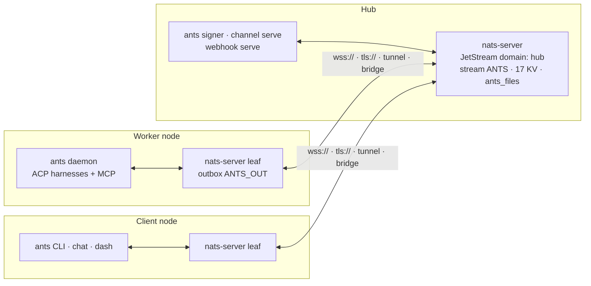

# ants

[](https://github.com/quanghle/ants/actions/workflows/ci.yml)

Headless coding agent teams across machines, communicating with each other and with humans over NATS.

## Why ants

Standalone coding agent CLIs run one session in one terminal on one machine. `ants` connects ACP (Agent Client Protocol) agents (`copilot`, `claude`, `codex`, `antigravity`, or custom harnesses) across machines over a shared NATS + JetStream bus:

- **Durable collaboration:** persistent inboxes, multi-agent channels, passive thread notes, capability routing (`messenger`), and bounded agent-to-agent turn budgets that escalate up configured chains before interrupting humans.
- **Isolation & guardrails:** per-thread git worktrees, role-scoped NKey/JWT credentials, end-to-end sealed human direct messages, tool allowlists and approvals, prompt and spend caps, and secret redaction.
- **Resilient transport:** works over `wss://`, `tls://`, private Dev Tunnels, or an HTTP/1.1 fallback bridge (`ants bridge`), with optional per-machine store-and-forward leaf nodes for offline operation.
- **Lean single binary:** one `ants` executable provides the CLI, terminal UIs (`ants chat`, `ants dash`), ant daemon, credential signer, channel manager, webhook/notification server, hook runner, and HTTPS bridge. Idle `ants daemon` keeps under 10 MB of private memory, enforced in CI ([footprint](docs/operations.md#footprint)).

## Architecture



- **Hub:** a `nats-server` with JetStream holding stream `ANTS` (inboxes, channels, notes, approvals, timelines, dead letters, admin orders), 17 KV buckets, and attachment store `ants_files`.
- **Leaf:** optional local `nats-server` (`127.0.0.1:4222`) per node with a store-and-forward outbox (`ANTS_OUT`) that drains to the hub on reconnect.
- **Daemon:** `ants daemon` runs per-ant ACP session pools, exposes collaboration tools to each session over MCP, and acks JetStream deliveries only after replies are stored. A harness definition's `protocol` key can run a CLI on its native protocol instead, behind an in-process ACP translator ([harness protocols](docs/config.md#harness-protocols)).
- **Humans, assistants & ants:** humans own threads, decide tool approvals, and converse through the CLI or `ants chat`; optional personal assistant ants triage queues under device-signed grants; capability-tagged worker ants collaborate within shared turn budgets.

See [docs/architecture.md](docs/architecture.md) for the store/subject model, delivery loop, MCP tools, channels, and escalation mechanics.

## Install a release

Each `v*` tag publishes [release](https://github.com/quanghle/ants/releases) archives of the `ants` binary for Linux x86_64 and arm64 (glibc 2.35+), macOS arm64 and Windows x86_64, with `SHA256SUMS` and build provenance attestations:

```sh
tag=v0.1.0 target=aarch64-apple-darwin   # or x86_64-unknown-linux-gnu, aarch64-unknown-linux-gnu
curl -fLO "https://github.com/quanghle/ants/releases/download/$tag/ants-$tag-$target.tar.gz"
gh attestation verify "ants-$tag-$target.tar.gz" --repo quanghle/ants   # optional
tar -xzf "ants-$tag-$target.tar.gz"
install "ants-$tag-$target/ants" ~/.local/bin/
```

Windows takes `ants-$tag-x86_64-pc-windows-msvc.zip`. A release needs the same nats-server and harness CLIs as a build from source (below). To cut a release, set `version` in `Cargo.toml`, merge, then push the tag `v<version>` (a suffix such as `-rc.1` makes a pre-release); running the Release workflow by hand only checks and builds.

## Install from source

Requirements: Rust 1.100+, [nats-server](https://github.com/nats-io/nats-server/releases) 2.15+, and at least one ACP harness CLI (`copilot`, `claude-agent-acp`, `codex-acp`, `agy`, or a custom command) on machines running `ants daemon`.

```sh
# From GitHub:
cargo install --locked --git https://github.com/quanghle/ants ants

# Or from a local checkout:
git clone https://github.com/quanghle/ants.git
cd ants
cargo install --locked --path crates/ants
```

Platform notes (Windows named pipes, cross-builds), automatic binary upgrade draining, and launchd/systemd service installation live in [docs/operations.md](docs/operations.md).

## Quick start

Bring up a local `nats-server`, config, background services, shell completions, and health check on a single machine:

```sh
ants setup --ant dev-a --workdir ~/src/some-repo
ants ask --wait @dev-a "summarise the open TODOs"
ants inbox                                          # unread replies across devices
ants colony                                         # active ants and harness status
ants channel create ops --member dev-a
ants post --wait '#ops' "@dev-a check the failing build"
ants                                                # full-screen terminal chat UI (also: ants chat)
```

Join an existing team hub as a human using shared bootstrap credentials ([docs/auth.md](docs/auth.md#registering-humans)):

```sh
ants login --hub wss://hub.example/nats --name alice --bootstrap bootstrap.creds
ants inbox
```

## Documentation

| Document | Contents |
|---|---|
| [docs/architecture.md](docs/architecture.md) | Wire stores and subjects, delivery retries, worktrees, colony, MCP tools, channels, escalations, dead letters |
| [docs/cli.md](docs/cli.md) | Full CLI command reference, environment variables, thread search/marks, `ants chat` and `ants dash` |
| [docs/config.md](docs/config.md) | `config.toml`, shared settings, harnesses, fallbacks, templates, manager ants, spend caps, permissions, redaction, schedules |
| [docs/auth.md](docs/auth.md) | NKey/JWT credentials, revocations, backups, device encryption and sealed messages, admin orders, assistants, GitHub login, OS keystores, ACLs |
| [docs/transport.md](docs/transport.md) | Hub configuration, reverse proxy, leaf nodes, store-and-forward outboxes, HTTPS fallback bridge, Dev Tunnels |
| [docs/webhooks.md](docs/webhooks.md) | HTTP webhook ingress, provider presets, human push notification sinks, quiet hours, digests, stand-ins |
| [docs/hooks.md](docs/hooks.md) | Read-only observer credentials, event feeds, JSON schemas, wire versioning |
| [docs/operations.md](docs/operations.md) | Platform specifics, binary upgrades, launchd/systemd units, `/healthz` and Prometheus metrics, daemon footprint |
| [docs/apple-container-demo.md](docs/apple-container-demo.md) | Isolated three-node local demo using Apple `container` |
| [contrib/skills/ants/SKILL.md](contrib/skills/ants/SKILL.md) | Agent skill teaching external coding agents to use the `ants` CLI |

## Contributing

Workspace crates: `ants-proto` (wire types and NATS permissions, no I/O), `ants-daemon` (bus, ACP pool, delivery, approvals, MCP server), `ants` (CLI and service binary), and `ants-test-support` (test helpers).

Run the full CI check suite locally before submitting changes (`rust-toolchain.toml` pins Rust 1.100):

```sh
scripts/check.sh        # fmt, clippy, test (v1 + JS ack/FC v2), and cargo-deny with warnings denied
```

- **Dependencies:** `.cargo/config.toml` enforces a 7-day minimum publish age; `deny.toml` governs allowed permissive licenses and advisories.
- **Wire compatibility:** `crates/ants-proto/tests/wire_snapshots.rs` pins wire JSON formats with [insta](https://insta.rs) snapshots following [docs/hooks.md](docs/hooks.md#versioning).
- **Issue & spec tracking:** work items and feature specifications are tracked in `bd` (`.bd/issues.jsonl`).
- **Security:** report vulnerabilities privately per [SECURITY.md](SECURITY.md).

## License

[MIT](LICENSE)
