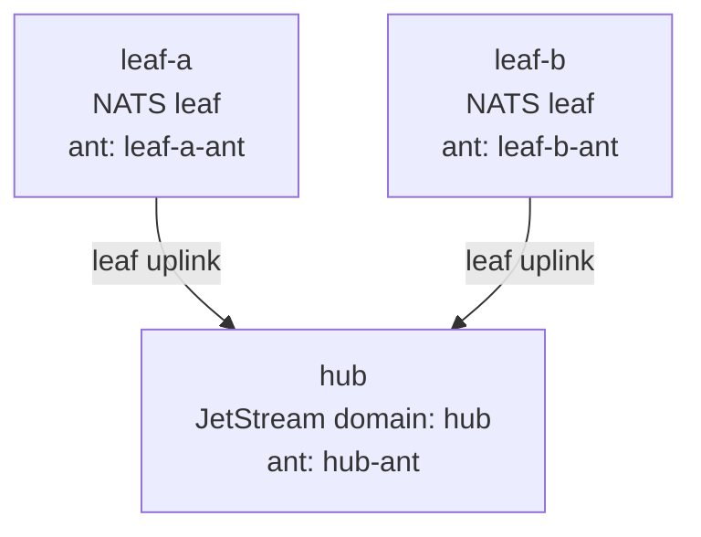

# Apple container demo

A local three-node team using [Apple container](https://github.com/apple/container), not Docker:



Each node is a separate Linux VM/container with its own NATS server, persistent ext4 volume, workdir, Copilot sign-in and
one `ants daemon` serving exactly one ant. The built-in messenger is disabled. The leaves use scoped NKey/JWT uplinks
and local JetStream domains `leaf-a` and `leaf-b`. Only the hub holds the team signing keys. The demo human `human` is
an [admin](auth.md#admins), and each node's daemon runs with
[host credentials](auth.md#machine-host-credentials) for its machine (`hub`, `leaf-a`, `leaf-b`), so admin orders such as
`ants ant pause`, `ants ant set` and `ants ant restart` reach every ant. This online demo requires
the hub to remain reachable; it does not provision [store-and-forward outboxes](transport.md#store-and-forward).

## Requirements

- Apple silicon Mac, macOS 26 or later, Apple `container` CLI with custom-network support, and `jq` on `PATH`.
- A running container service (`container system start`).
- Network access to the image registries, Debian packages, crates.io, npm and GitHub Copilot.
- A GitHub account with Copilot CLI access. Real prompts use the account's model allowance.

No host Rust, Node.js, NATS or Copilot installation is required. The image builds the workspace with the pinned Rust
toolchain and `Cargo.lock`, and installs NATS 2.15.3 and Copilot CLI 1.0.112. The Rust image tag must track
`rust-toolchain.toml` when that toolchain changes. Client telemetry, OpenTelemetry and automatic Copilot updates are
disabled; GitHub's server-side service accounting is unaffected.

## Start

From the repository root:

```sh
scripts/demo-apple-containers.sh build
scripts/demo-apple-containers.sh up
scripts/demo-apple-containers.sh smoke
```

The build VM gets four CPUs and 4 GiB of memory. The first build downloads dependencies and compiles a Linux release
binary. `up` also builds when the image is absent; rerun `build` after source changes. The smoke check verifies all three
live Copilot-backed ants and their MCP sockets, pauses and resumes each ant by admin order from the hub, then sends notes
from every node, reading them from every other node through the hub. It makes no model calls and needs no Copilot
sign-in.

Each container gets two CPUs, 2 GiB of memory and a sparse 4 GiB named volume. Linux-native volumes support the Unix
socket permissions used by the ACP MCP bridge. A dedicated network connects the nodes; no ports are published on the
host. NATS client ports and daemon metrics listen only on each container's loopback interface. The hub's authenticated
leaf port listens on the demo network. Production NATS configuration, services and credentials stay untouched.

## Sign in and send work

Sign in separately in each container, following the displayed GitHub device-code flow:

```sh
scripts/demo-apple-containers.sh login hub
scripts/demo-apple-containers.sh login leaf-a
scripts/demo-apple-containers.sh login leaf-b
scripts/demo-apple-containers.sh ants hub ask --wait @hub-ant "Identify the node."
scripts/demo-apple-containers.sh ants hub ask --wait @leaf-a-ant "Identify the node."
scripts/demo-apple-containers.sh ants leaf-a ask --wait @leaf-b-ant "Identify the node."
scripts/demo-apple-containers.sh ants hub ask --wait @hub-ant \
  "Ask leaf-a-ant and leaf-b-ant to identify their nodes, then summarize both replies."
```

The default Copilot model is left unchanged. Copilot runs tools unasked, as with the built-in harness elsewhere; no
host directories are mounted into running nodes. Do not copy production secrets or repositories into the demo workdirs.
Authentication is intentionally interactive: host GitHub tokens and Copilot configuration are
not copied or forwarded. Sign-in data stays under `/demo/home/` in each node's volume, potentially in plaintext where no
credential store is available.

## Inspect and stop

```sh
scripts/demo-apple-containers.sh status
scripts/demo-apple-containers.sh logs leaf-a
scripts/demo-apple-containers.sh ants hub thread list
scripts/demo-apple-containers.sh down
```

`down` removes only the named demo containers and network after checking ownership labels. It preserves the image and
named volumes `ants-demo-hub`, `ants-demo-leaf-a` and `ants-demo-leaf-b`, including generated NATS credentials,
JetStream data, Copilot sign-ins and ant homes. `up` refuses existing containers; run `down` before recreating the
topology. After a failed `up`, inspect the node logs and run `down` before retrying.

`ANTS_DEMO_NAME` changes the resource prefix (default `ants-demo`); `ANTS_DEMO_STATE` changes the host directory holding
the ownership marker, temporary build context and smoke logs (default `~/.local/share/ants/apple-container-demo/`).
Set both for a second independent demo. Nonempty directories without the demo marker and resources belonging
to another state directory are refused. `ANTS_DEMO_COPILOT_VERSION` changes the npm version on the next `build`.
