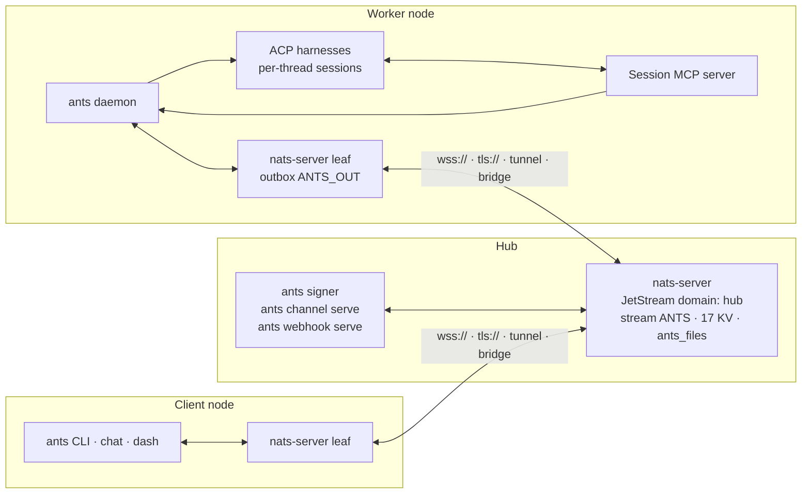
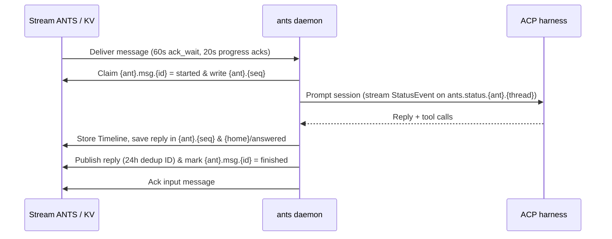
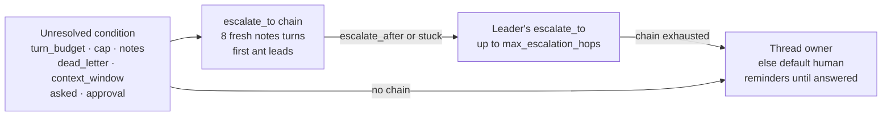

# Architecture and wire model

`ants` connects headless ACP (Agent Client Protocol) coding agents and human operators across machines over NATS and JetStream. One `ants` binary serves every role: CLI and terminal UIs, ant daemon, credential signer, channel manager, webhook and notification server, event hook runner, stdio MCP bridge, and HTTPS fallback bridge.



- **Hub:** one `nats-server` with JetStream holding stream `ANTS`, 17 KV buckets, and the attachment store `ants_files` (`ants init`), plus stream `ANTS_SENSE`, which machine hosts create. With `ants auth`, every ant, human device, assistant, webhook, observer, leaf uplink, machine host, and channel manager connects using role-scoped NKey/JWT credentials ([auth.md](auth.md)).
- **Leaf:** optional per-machine `nats-server` (`ants leaf config`) on `127.0.0.1:4222` with a store-and-forward outbox (`ants leaf outbox`), run as a service of its own or by `ants daemon` ([`[nats_server]`](config.md#managed-nats-server)). Local `ants` processes target `127.0.0.1:4222`; only the leaf uplink crosses the network ([transport.md](transport.md)).
- **Daemon:** `ants daemon` serves ants over per-ant NATS connections and durable consumers, runs up to `max_harnesses` ACP processes per ant, enforces tool allowlists, prompt limits, and spending caps, refreshes colony heartbeats, and exposes an MCP server to each session ([config.md](config.md)).
- **Ants and humans:** ants are named agents (`dev-a`, `reviewer`, `messenger`) with a workdir, harness, capabilities, and optional `whoami`. Humans (`human` by default, or named users from `ants auth user NAME --human` or `ants login`) own threads they start and decide tool requests. Unaddressed `ants ask` messages go to the human's assistant while its grant stands, else to `messenger` for capability routing. Agent-to-agent messages share a per-thread turn budget (default 8).

## Stores and subjects

| Store / subject | Storage / TTL | Purpose |
|---|---|---|
| Stream `ANTS` | File, 30d | Captures `ants.inbox.>`, `ants.notes.>`, `ants.approvals.>`, `ants.dead.>`, `ants.chan.>`, `ants.timeline.>`, `ants.admin.>`; direct gets enabled; republishes `ants.inbox.*.*` to `_INBOX.<to>.stored.<from>`; `max_consumers` 10000. |
| KV `ants_colony` | Memory, 30s | Live `ColonyEntry` per ant (`<ant>`), refreshed every 10s; expiry markers enabled; `max_consumers` 10000. |
| KV `ants_sessions` | File, 30d | Thread ACP session IDs with the harness each ran in (`<ant>.<thread>`), spend/escalation/narrowing state, thread origins, channel seen cursors, mention markers, `_storage.*.*.warned` notes. |
| KV `ants_attempts` | File, 30d | Started delivery markers and saved replies (`<ant>.<seq>`), message marks (`<ant>.msg.<id>`), withdrawals an assistant recorded for its human while no daemon of the ant answered (`<ant>.msg.<id>.<assistant>`), unserved-ant markers (`<sender>.unserved.<id>`), wake marks (`<ant>.wake.<hash>`, kept 7 d, see [Wake requests](#wake-requests)). |
| KV `ants_channels` | File, none | `ChannelEntry` (`<channel>`): members, optional messenger, optional owner ant, optional description; `max_consumers` 10000. |
| KV `ants_humans` | File, none | Registered humans (`<human>`), written on CLI connection, each human's signed assistant grant (`<human>.assistant`), enrolling the assistant as a device when `ants assistant seal on` did, and signed consent to the assistant's decisions and orders (`<human>.confirmed`, `<human>.preallow`), written only by that human; `max_consumers` 10000. |
| KV `ants_chains` | File, none | Persistent `escalate_to` chains (`<ant>`), readable after colony expiry. |
| KV `ants_machines` | File, none | Per-machine `MachineRecord` (`<machine>`): the ants its daemon serves (built-in messenger and sage left out), shared-settings `drift` by ant, host name, ants version, and time, put on start and on each change with the machine's host credentials (`ants auth host`); never deleted, so an ant keeps its machine after its colony entry expires (`ants machines`). Also the outcome of each admin order to the machine's ants (`<machine>.<ant>.<id>`: applied, refused, or held, [auth.md](auth.md#admin-orders)), the machine's held assistant orders (`<machine>.held`), and `_account`: the machine holding the team's account key, put by `ants signer` whenever it connects. Each host writes only its own keys; humans read all. |
| KV `ants_links` | File, 30d | Verified `origin_thread` handoffs (`<from>.<thread>.<to>`). |
| KV `ants_owners` | File, 30d | Thread `owner` (`<thread>.<recipient>`, or an assistant's for its human `<thread>.<ant>.<human>.<assistant>`); first record wins (`discard_new_per_subject`, 30d dedup window, no delete/purge). |
| KV `ants_read` | File, none | Per-human inbox read marker (`<human>`: `below` + `read` set + `unread` set of messages marked unread again) and channel read markers (`<human>.chan`: one `below` + `read` set per channel), each shared across devices. |
| KV `ants_presence` | Memory, 30s | Per-device follow presence (`<human>.<device>.<inbox\|approvals>`), refreshed every 10s; each human writes its own keys and reads every human's (`ants chat` shows who is online), ants read none. |
| KV `ants_devices` | File, none | Directory of human devices' encryption keys: each device's user JWT binding its `ants-xkey:` (`<human>.<device>`), put by its CLI on connecting, revoked keys (`revoked.<U...>`), put by `ants auth revoke`/`push`, and each assistant's user JWT (`<assistant>.assistant`), put by its daemon, against which readers check acts for its human; humans read all and put only their own devices', an assistant only its own record, and ants direct-get the assistants' records and the revocations. |
| KV `ants_notify` | File, none | Per-human snooze deadline, muted threads and channel notify levels (`<human>`), and notices held back for a digest (`held.<human>`). |
| KV `ants_reactions` | File, 30d | Message reactions (`<reactor>.<message_id>.<reaction>`); humans write/delete their own keys and read all; ants neither read nor write, asking `ants signer` instead. |
| KV `ants_threads` | File, none (per-message TTLs allowed) | Shared thread titles (`title.<thread>`, also direct-got read-only by ants to title draft pull requests), TL;DRs (`summary.<thread>`), and done states (`done.<thread>`, also direct-got read-only by ants, with `reminders.<human>`, to stop escalation reminders, and read by each ant's durable consumer `done-<ant>` to tell its provider of [threads marked done](#lifecycle-events)), plus per-human pin/archive/keep marks (`marks.<human>`) and due times, reminders and threads snoozed from home in `ants chat`, in one entry (`reminders.<human>`), and the marks and snoozes an assistant sets for its human under keys of its own (`marks.<human>.<assistant>`, `reminders.<human>.<assistant>`), honoured only while the human's grant names it and where the human's own mark or snooze is absent; `ants thread list` prunes entries of expired threads; `max_consumers` 10000. |
| KV `ants_identities` | File, none | One `AntIdentity` per ant (`<ant>`), never expiring: random 128-bit `id` and `born`, set by the ant's daemon on start when absent; `avatar` seed and `color` (`ants ant avatar`); completed prompt count (CAS-updated by the serving daemon); `moved` (`ants ant export --move` sets, `ants ant unseal` clears; while set no daemon serves the ant); `cloned_from` (set by `clone` orders). `ants ant import` creates a record via KV create, refused on name or id collision. Each daemon writes its own key; ants, assistants, and humans read all; `ants auth revoke ANT` deletes it. Also each ant's shared settings (`<ant>.settings`: role settings and core memories), written by host credentials only and served only when signed with the ant's credentials for the bucket's incarnation ([config.md](config.md#shared-settings)). Also `_incarnation`, the marker `ants init` writes when absent, or anew with `--identities-restored` after a restore from backup: without it no shared settings are served. |
| Store `ants_files` (stream `OBJ_ants_files`) | File, 30d | Attachment bytes as chunks of up to 128 KiB on `$O.ants_files.C.<from>.<inbox\|notes\|chan>.<target>.<id>.<n>` (the handle follows the subject of the carrying message `{id, name, mime, size, sha256}`; chunk 0 carries it in header `Ants-Attachment`); up to 8 attachments of 8 MiB each per message; each chunk stored once (24h duplicate window), no delete/purge; direct gets. Senders write their own, ants read those of messages they read, humans read all. Also the exports of ants' providers that admin orders carry by reference (`$O.ants_files.C._admin.<id>.<machine>.<n>`, up to 64 MiB), read and written by humans and the host credentials of that machine. |
| Stream `ANTS_SENSE` | File, none | Sense's event log of each ant, one subject per sense identity (`ants_sense.<id>`, a ULID), outside `ants.>`, which every human subscribes to. Each event (`{sense, index, prev, at, ant, machine, kind, data, credentials, signature}`) holds its position in the log from 1, the SHA-256 of the previous event's stored bytes, and is signed with the ant's credentials (their user JWT and an Ed25519 signature of the event without its signature, under context `ants-sense-event-v1`), as read when the daemon starts serving the ant, and read again when it serves the ant again with them changed, as after a revoke and re-add; the daemon serving the ant appends it with `Nats-Expected-Last-Subject-Sequence` set to the last sequence it read of the subject, so a stale writer is refused and reads what it missed first. Readers check each event's position, hash, ant, and signature against the team account and the revocations in `ants_devices`; an event's ant is the one reading under its current name or one of its earlier names its home lists (`.sense/names`), the log's events being of one name at a time: the first event's, until an event of kind `ant_renamed` (data `{from}`) of the ant's next name, from the name before, which the daemon serving a renamed ant appends before its first event under the new name; events imported from another bus ([config.md](config.md#senses-part)), signed with credentials of that bus, verify on the word of the event of kind `log_imported` after them (data `{accounts, through}`, `through` the last event imported, `{index, sha256}`), signed on this bus: a reader finding an event whose signature does not verify here looks ahead for the first such event of the ant whose `through` reaches it, and checks the events up to `through` against `accounts` instead, as of their time, the event at `through` matching its hash; the daemon keeps what it verified, with the first break, the log's size (the bytes of the messages of its subject read, as appended, those breaking the chain too: a running total, so no read of the whole log measures it) and the name the events are of by then, in the ant's home (`.sense/chain.json`), which `ants doctor` reports, warning when the log holds over 32 MiB. Its incarnation is the stream's creation time. No limits, no delete/purge, direct gets, no consumers. Only machine host credentials (and a leaf's uplink carrying them) create it, with this one config (creating it otherwise refused, so a stream another made differently, such as one republishing, is never written to), write and read it; ants, humans, assistants, webhooks, observers, and the channel manager reach none of it. |
| KV `ants_webhooks` | File, 7d | Webhook event hashes (`<webhook>.<hash>`), schedule firings (`<schedule>.<unix_time>`), and hourly `<webhook>.webhook` / `channel-manager.serve` version markers. |
| Core NATS | Unstored | `ants.status.<ant>.<thread>`, `ants.cancel[led].<ant>.<thread>`, `ants.queue[d].<ant>`, an assistant's `ants.cancel.<ant>.<thread>.<assistant>` and `ants.queue.<ant>.<assistant>`, `ants.chanadm.<channel>.<ant>`, `ants.reactions.<ant>[.react]` (answered on `_INBOX.<ant>.reactions`), `ants.enroll.<ant>[.reply]`, `ants.renew.<name>[.reply]`, `ants.login.<name>[.reply]`, `ants.antreq.<manager>[.reply]`. |

### Daemon notices

An `[ants]` message a daemon sends of its own, rather than an ant's answer, carries `notice` with its kind: `spend` (a spend warning), `signed_out`, `quota`, `failing`, `no_fallback`, `gave_up` (a dead letter), `withdrawn`, `expired` (a session's kept branch), `unserved`, `assistant` (what an assistant did for its human), `in_place` (an answer or decision taken by another), `request_expired`, `steered` (a later message steering the prompt took its answer) or `mcp_sign_in` (an MCP server the harness signs in to whenever it needs it waits for a browser sign-in, or failed to sign in). A reply or follow-up never copies it. `ants chat` shows such a message as a dim system line that makes no thread finished or unread; only the kinds that hold the thread until a human acts (`signed_out`, `quota`, `failing`, `no_fallback`, `gave_up`) count as what the thread is stuck on; those and `mcp_sign_in`, which the ant answers without, reach the human's inbox (an `mcp_sign_in` one leaves the thread waiting on the human rather than stuck) and are pushed by `ants webhook serve` (kind `notice`). Notices carrying an escalation keep the escalation's handling.

### Identifiers and durations

- User, channel, thread, and JetStream domain IDs use 1–64 characters of `a-z`, `0-9`, and `-`, starting with a letter or digit (`bootstrap`, `channel-manager`, `revoked`, and `signer` are reserved: no ant, human, webhook, or device takes them).
- Machine and harness names also allow `_` (machine names allow uppercase ASCII and must differ from `js_domain`).
- Durations require whole-number units ordered largest first (`s`, `m`, `h`, `d`: `90s`, `10m`, `1h30m`) or `0`; bare non-zero numbers are rejected.

## Delivery

### Pool, worktrees and at-least-once retries

Each ant runs up to `max_harnesses` (default 4) ACP processes (or CLIs of a native protocol behind an in-process ACP translator, [config.md](config.md#harness-protocols)), concurrent across threads and sequential per thread. Idle harnesses stop after `idle_timeout` (`10m`), or immediately while system memory is low ([`[memory_pressure]`](config.md#memory-pressure)), and resume via ACP `session/load` (`<ant>.<thread>` in `ants_sessions`), rebuilding from stored thread history if `session/load` fails ([config.md](config.md#lost-sessions-and-context-window)). First Ctrl-C/`SIGTERM` drains active prompts; second Ctrl-C exits immediately.

A message on a thread with a running prompt steers it: a human's, human channel replies that wake the ant included, and another ant's that starts something rather than answers (not a reply, notice, escalation, approval request or webhook's message). A message marked `queue` (`ants ask --queue`, `/later` in `ants chat`), and the ant's own (`handoff`), wait their turn instead.

- **Joining:** a harness that takes steers (protocols `claude`, `codex`, `copilot-sdk`, or an ACP agent advertising `ants/steer` in its capabilities' `_meta`, sent `_ants/steer`) gets the message in the running turn, after an `[ants]` line naming its sender. The prompt's answer replies to the last message that joined it; each message before ends with a `steered` notice to its sender naming the message that took the answer, or, for a channel post, the ant's own message, a webhook's or a thread out of turns, with no reply and a `no_reply` timeline entry (why `steered`). A steer the harness refuses, as at the very end of a turn, waits and runs next.
- **Interrupting:** any other harness has the prompt cancelled and the message run next in the same session, ahead of ordinary waiting messages and after earlier steers. The cancelled prompt's partial output is stored and answered without retry, dead letter or escalation. In-flight tool calls are cancelled, not resumed ([config.md](config.md#prompt-limits-and-spending-caps)).

A human's steer renews the thread's turn budget and allowance as any human message does; an ant's does not.

With worktrees on, each thread gets its own git worktree at `<home>/worktrees/<thread>` on branch `ants/<ant>/<thread>` from `HEAD`, pruned once `<ant>.<thread>` expires from `ants_sessions` (preserving branches with unmerged commits and appending an `[ants]` notice). Worktrees are on by default for a workdir inside a git work tree, and not ignored by it, with `max_harnesses > 1` (logged at daemon start); `worktrees = true` (`--worktrees`) forces them on and `worktrees = false` (`--no-worktrees`) keeps every thread in the shared workdir. Trade-offs: one checkout per thread (plus build outputs) on disk, a branch per thread to merge or delete, and threads not seeing uncommitted changes of the workdir; see [config.md](config.md#worktrees). `ants daemon` and `ants doctor` warn when `worktrees = false` leaves `max_harnesses > 1` sharing a git workdir.

With `worktree_base = "upstream"` (default `"head"`), a thread's new branch starts from the default branch of the repository's default remote (the current branch's upstream remote, else `origin`): `git fetch` runs first (60 s timeout, no credential prompt), then the branch starts from `refs/remotes/<remote>/HEAD`, else from the current branch's upstream. Without a remote, or when the fetch fails or neither ref is known, the branch starts from `HEAD` with a logged warning. Branch commits already in that remote branch count as merged when pruning and in the `[ants]` notice.

With `publish = "draft-pr"` (default `"off"`) and worktrees on (set or by default), a prompt that ends with new commits on the thread's branch pushes `ants/<ant>/<thread>` to the default remote and opens a draft pull request with `gh` (title: the thread's title, read by direct get ([auth.md](auth.md#wire-acls-and-verification-invariants)) unless sealed between humans, else the first line of the thread's first prompted message; body: the ant and thread id), or finds the open one updated by the push. The push needs an allow rule such as `execute:git push origin ants/<ant>/*` or an approval, like a tool call ([config.md](config.md#tool-permissions)). The reply carries an `[ants]` line with the pull request URL, or with what was rejected or failed; nothing is retried until the branch has commits the remote lacks. A branch the remote already has as it is, or a prompt cancelled by a human, publishes nothing. `git push` and `gh` run without prompts (`GIT_TERMINAL_PROMPT=0`, `GH_PROMPT_DISABLED=1`), bounded by timeouts (120 s, 60 s), with `gh` authenticated on the machine.

Attachments of a prompted message (an inbox message, or a channel post read under its `chan` handles) end the prompt's text with one line each: `[ants] Attached: "NAME" (MIME, SIZE bytes), handle HANDLE`, then how to read it with the `read_attachment` MCP tool. When the harness's ACP `initialize` advertises `promptCapabilities.image`, each `image/png`, `image/jpeg`, `image/gif`, or `image/webp` attachment is read from `ants_files` with the ant's credentials, checked against its size and SHA-256 (missing chunks of an attachment made within the hour, or carried by a message the hub stored within the hour, perhaps still on their way from a leaf's outbox, are waited for up to 60 s; likewise for `read_attachment` on the handles of the message being handled), and handed after the text as an ACP image content block, its line saying so. Other attachments, all attachments on harnesses without image support, and attachments that cannot be read (invalid reference, missing or mismatched bytes, with the reason in the line) stay lines only; the prompt runs regardless. Earlier channel posts shown as thread context and rebuilt session history entries list attachments the same way, one line each with the handle from the subject and nothing read from the store; in a rebuilt session these lines count toward the history budget.



In-hand messages send 20 s progress acks against a 60 s `ack_wait`, acking only after storing the reply (for a turn that sends none, after publishing its `no_reply` Timeline record, best effort):

1. Claims `<ant>.msg.<id>` = `started` in `ants_attempts` (unless already `withdrawn`, or withdrawn by a record of the human's assistant stored before the claim, [auth.md](auth.md#tools-acting-for-its-human)), then writes `<ant>.<seq>` before prompting so redeliveries after a crash prepend a prior-tool-call warning. After a failed attempt it swaps `started` for `retrying` (compare-and-set) before handing the message back for a retry, unless the attempt stored a reply its redelivery only sends again, and likewise before holding it for a sign-in or a provider limit met after tools may have run (a tool call started, or an earlier attempt was cut off), the mark's `held` naming which; taking the message up again claims `started` by compare-and-set on that `retrying` mark.
2. Saves the finished reply in `<ant>.<seq>` and `<home>/answered` before publishing with 24 h dedup ID `reply-<ant>-<envelope_id>`, preventing re-prompts across post-generation disconnects or offline leaf outboxes, then marks `<ant>.msg.<id>` = `finished`.
3. Streams unpersisted `StatusEvent` JSON on `ants.status.<ant>.<thread>` (`state`, 250 ms batched `message`/`thought`, `tool`, `plan`, `queued`, `approval`, `escalated`, `asked`, `decided`).
4. Stores the prompt's tool calls and plan as compact `Timeline` records on `ants.timeline.<thread>.<ant>` (at most one every 30 s while calls changed, the rest when the prompt ends; ≤ 50 entries each, ≤ 200 calls per prompt with the rest counted; titles and paths redacted as status is, never inputs, outputs, text, or thoughts), plus a `no_reply` entry for a turn that sends no reply (why: `reply_to_own`, `completed` or `steered`, `complete`'s reason, and the final text that went to nobody, redacted as replies are). A failed store is logged and dropped ([hooks.md](hooks.md#timeline-on-antstimelinethreadant)).

### Queue and withdrawal

- `ants queue ANT` queries `ants.queue.<ant>` (5 s timeout), combining messages held by the active daemon, messages awaiting redelivery (delivered but not acked, found from where the daemon's answer says its inbox and channel consumers stand), and up to 100 undelivered inbox messages and channel posts that wake the ant (an @mention of a member, or a triage for the messenger) from `ANTS`. A message awaiting a retry after a failed attempt (marked `retrying`) shows `awaiting a retry after a failed attempt`, and one held for a sign-in or a provider limit after its tools ran (marked `retrying`, `held` `sign_in` or `provider_limit`, as is the `held` field of `--json`) shows `held for a sign-in` or `held for a provider limit`; both can be withdrawn; one awaiting redelivery still marked `started` (its daemon stopped mid-attempt, or the attempt stored its reply) shows `awaiting redelivery (started; not withdrawable)`. Without `ANT`, `ants queue` asks the daemons of every ant live in `ants_colony` at once and lists their messages with an `ANT` column, leaving out ants with nothing waiting; an ant whose daemon does not answer is reported on stderr, and the command fails only when none answers. `--json` lines then carry an `ant` field.
- `ants withdraw ANT MESSAGE` atomically creates `<ant>.msg.<id>` = `withdrawn` in `ants_attempts` (losing to `started` if prompting already began; sign-out and provider-limit holds before tool execution clear `started`, and those after it swap `started` for `retrying`, so messages stay withdrawable), or swaps a `retrying` mark for it by compare-and-set: of the withdrawal and the redelivery claiming `started`, exactly one wins, and the loser finds the winner's mark. When its turn arrives, the daemon replies `[ants] Withdrawn by <human> before <ant> was prompted with it (ants withdraw).` (`before <ant> retried it after a failed attempt` for one awaiting a retry, `before <ant> retried it after holding it for a sign-in` or `for a provider limit` for one held, the withdrawal keeping the `held` of the `retrying` mark) and acks without prompting. An assistant withdraws for its human through the ant's daemon instead, or, while none answers, by a record under `<ant>.msg.<id>.<assistant>` the daemon honours before taking the message up (`withdraw_for_human`, [auth.md](auth.md#tools-acting-for-its-human)): the mark carries `on_behalf_of`, the reply reads `[ants] Withdrawn by <assistant> for <human> before <ant> was prompted with it.`, and `ants queue` shows `withdrawn by alice via pa`.
- **Unserved-ant notices:** daemons (via `sentread-<ant>`), `ants webhook serve` (with `escalations = true`), and `ants inbox -f` check sent messages every minute. If a message waits ≥ 15 m for an ant absent from `ants_colony` ≥ 15 m, the first watcher to claim `<sender>.unserved.<id>` in `ants_attempts` notifies the owner/sender once with `ants withdraw` instructions and up to 5 capability-matching live peers.

## Colony, identity and memory

Each daemon publishes a `ColonyEntry` at `<ant>` in `ants_colony` every 10 s (and immediately on state transitions), deleting it on clean exit (`30s` TTL with `MaxAge` delete markers; `ants colony` marks entries without a heartbeat for 20 s as `stale`):

- **Identity & runtime:** `machine` (config `machine`, else the host name), daemon `instance`, `harness`, `agent` (`{name, version}` from ACP `initialize`), `model` (`{model, reasoning_effort, context}`), `workdir`, `capabilities`, `whoami`, `escalate_to`, `drift`, `version`, `perms`, `started_at`, `heartbeat_at`, `activity` (`idle` / `working`), `handling` count, live `harnesses` count, and `mcp` (`true` when the harness's protocol reports its MCP servers, which gates the ant view's mcp tab).
- **Hold states:** `signed_out` (`{since, sign_in?}`), `limited` (`{kind: "rate_limit" | "quota", since, until}`), and `failing` (`{since, error}`), plus `fallback` (`{name, since}`) while one of the ant's `fallback` harnesses or models answers instead, and `paused` (`{since, by?}`: `by` names the admin whose order paused it) while `paused = true` holds it ([config.md](config.md#pausing-an-ant)).
- **Memory pressure:** `memory_low` (`{since, available, max_harnesses}`) while the machine's available memory is below `[memory_pressure]` `min_available` ([config.md](config.md#memory-pressure)).

Per-ant prompt instructions and state isolation:

- `whoami` (`--whoami TEXT`): role description prepended to every prompt and published in `ants_colony` (keep secrets out; `route` matches `capabilities`, not `whoami`).
- `memory` and `tasks` (`--memory`, `--tasks`): private instructions prepended to every prompt.
- The provider's brief: in the first prompt of a session, after these instructions ([Briefs](#briefs)).
- `env` (`--env NAME=VALUE`): literal environment overrides passed to the harness and tool subprocesses (e.g. `BD_DB = "/srv/ants/dev-a/.bd/bd.db"`).

## Providers

An ant's provider holds its identity, memories and work. Its `provider` setting ([config.md](config.md#providers)) names built-in sense (crate `ants-sense`, the default), an external provider, an MCP server serving its tools alone, or none. Sense runs inside the daemon: one `Sense` serves all the ants of a daemon process, each call naming its ant. The daemon connects the ant's provider when the ant starts and hands it to the ant's MCP server, which serves its tools to every session of the ant ([MCP tools](#mcp-tools)); no harness needs configuring for them. The daemon also asks it for briefs and sends it lifecycle events. An ant served by another provider never reaches sense, so no sense id is minted in its home. An ant with none has no provider, its harness's own tools serving its memory and tasks.

Built-in sense implements the same interface (`ants_proto::provider::Provider`) that an external provider serves over the provider protocol, so switching an ant between providers changes nothing else in ants. A provider never reads an ant's messages, prompts or replies. It sees only:

- its own tool calls;
- the lifecycle events;
- what the ant passes it.

Sense asks nothing of humans: no approvals, gates, review queues or notifications. What it gives an ant, what an operator sees of it and its limits are in [sense.md](sense.md).

### Provider protocol

The protocol is JSON-RPC 2.0 over the provider process's standard input and output. Its types are in `ants_proto::provider`, pinned by the wire snapshots:

- Each message is one line: a compact JSON object in UTF-8 followed by `\n`.
- There are no batches.
- The provider writes its logs to standard error.

ants opens with `initialize`, whose params are:

- `protocol_versions`: the versions ants speaks, currently `[1]`;
- `capabilities`: what ants uses;
- `client`: `{name, version}`.

The provider answers with:

- `protocol_version`: one of those offered, the highest it speaks;
- `provider`: `{name, version}`;
- `capabilities`: what it implements.

Without a common version, the provider answers with error `-32002`. Both sides then use only the capabilities both declared. ants declares every capability, `wake` included. Sense declares `tools`, `context`, `events`, `wake` and `export`.

| Method | Direction | Capability | Params | Result |
|---|---|---|---|---|
| `initialize` | ants → provider | | `{protocol_versions, capabilities, client}` | `{protocol_version, provider, capabilities}` |
| `tools/list` | ants → provider | `tools` | none | `{tools: [{name, description, input_schema}]}` |
| `tools/call` | ants → provider | `tools` | `{name, arguments, context, format}` | `{text}` or `{json}`, with `is_error: true` for a refusal |
| `brief` | ants → provider | `context` | `{context, budget, reason}` | `{text}` |
| `event` | ants → provider | `events` | `{id, ant, identity, thread?, at, kind, …}` | `{}` |
| `memories` | ants → provider | `memories` | `{ant, identity}` | `{memories: [{key, content}]}` |
| `export` | ants → provider | `export` | `{ant, identity}` | `{provider, data}` |
| `import` | ants → provider | `export` | `{ant, identity, export}` | `{}` |
| `wake` | provider → ants | `wake` | `{ant, thread?, text, id}` | `{thread}` |

Tools:

- A provider names its tools without a prefix: 1-32 characters of `a-z`, `0-9` and `_`. Its own name is 1-32 characters of `a-z`, `0-9` and `-`.
- ants serves each tool as `<provider>_<tool>` (`sense_recall`), adding a boolean `json` argument to its schema. `json: true` sets the call's `format` to `json`; otherwise the answer comes as brief text.
- The ants MCP server asks the provider for its tools at each `tools/list` (5 s bound), so a session listing them again sees a provider's tools come and go. A failing list leaves the provider's tools out and ants' own in place. A tool whose name is invalid, whose schema is not an object, or whose served name is one of ants' own tools is left out, logged once.
- A call answers within 30 s. One that does not reach the tool (the provider down or the capability not agreed), times out, or has no context yet (no message on the thread handled since the daemon started, or the ant's identity record absent or unreadable) fails with an `[ants]` line saying why. A refusal (`is_error`) fails with the provider's text; a `json` answer comes as structured content beside its JSON text.
- Sense serves at most 12 tools: `brief`, `remember`, `recall`, `vote`, `checkpoint`, `handoff`, `task`, `promise`, `remind`, `persona`, `skill` and `dream` ([sense.md](sense.md#what-an-ant-gets)). Each brief of a session notes the session's harness, model and machine on the ant's card.

Calls and events:

- A tool call's and a brief's `context` is what ants knows of the call, never taken from the ant's text: `ant`, `identity` (the id of the ant's identity record), `thread`, `origin`, `harness`, `model`, `machine`, `repo` and `at`.
  - `origin` is `{by, channel?}`, where `by` is `{kind: "human" | "ant" | "webhook", user}` or `{kind: "provider", name}`.
  - The daemon keeps each thread's origin from the messages it handles on it, taking for each, in this order: a provider's [wake request](#wake-requests) as the provider's; a webhook's or schedule's message, or one on a thread a webhook or schedule narrowed, as the webhook's (the ant passing such a thread on standing for it); a thread an ant started with a channel post as that ant's; one a human started as that human's, as is a message an assistant sends on a human's behalf; anything else as the sender's. A post's, or a resumed channel thread's, `channel` is its channel.
  - The first message's origin stays, except that a message from a webhook or schedule makes a thread untrusted for good: a human's message or a wake later does not make it trusted again. So a thread a wake starts is the provider's, and a wake on an existing thread leaves its origin as it was. The daemon stores a thread's origin whenever it changes (`<ant>.<thread>.origin` in `ants_sessions`) before handling the message, and reads it back for a thread it has not settled since it started, so after a restart a thread a webhook reached stays untrusted and a tool call carries the origin before the thread's next message. A [clone](auth.md#cloning-an-ant-by-order) gets the origins of the ant cloned under its own keys, so it carries on with them as well.
  - `repo` is the remote of the git repository the thread's session works in, as `host/path` (no scheme, user, port or `.git`; `git@github.com:o/r.git` is `github.com/o/r`): remote `origin`, else the first with a URL, read from the repository's config file (a linked worktree's from its main repository) once as the session opens, without running git, so `insteadOf` rewrites and included files do not apply. It is left out outside a git repository or for one without a remote.
- `brief.budget` is in bytes of UTF-8, 8000 by default. `reason` is `started`, `loaded` or `rebuilt`.
- Event `kind`s, with what each adds:
  - `ant_added`, `ant_moved`, `ant_retired`, `ant_revived`;
  - `ant_renamed` (`from`);
  - `ant_cloned` (`from`, `from_identity`);
  - `thread_started` (`origin`; `repo`, the repository of the ant's working directory, named and left out as the context's `repo`);
  - `thread_done`, `thread_expired`;
  - `session_lost`;
  - `session_rebuilt` (`reason`: `lost` or `overflow`).
- Events are sent in order per ant and at least once; a repeat carries the same `id`. A provider acks a kind it does not know.
- A wake request's `id` makes it idempotent; it names a thread, or none for a new one.

| Error code | Meaning |
|---|---|
| `-32700`, `-32600`, `-32601`, `-32602`, `-32603` | JSON-RPC's parse error, invalid request, method not found (a method of a capability not implemented), invalid params (such as an unknown tool), internal error |
| `-32001` | The method's capability was not agreed at initialize |
| `-32002` | No common protocol version (`data.supported` lists the provider's) |
| `-32003` | Unavailable for now |

### Briefs

When a session of a thread starts, is loaded (resumed after an idle stop or a restart) or is rebuilt (after a failed `session/load`, a clone, a session that ran in another harness or a [context-window overflow](config.md#lost-sessions-and-context-window)), the daemon asks the ant's provider for its brief, `reason` telling which, when the provider agreed the `context` capability. The first prompt of the session then reads:

```text
[ants role dev-a]
Maintain the Rust backend.

[ants memory]
Use notes.

[ants tasks]
Use tickets.

[ants brief from sense]
The brief's text.

[ants] The earlier session of this thread could not be resumed, … (a rebuilt session only)
The thread's history (a rebuilt session only)

The message.
```

- The brief follows the configured instructions (`whoami`, `memory`, `tasks`), whichever of them the ant has, and comes before the history that seeds a rebuilt session. Later prompts of the session carry the instructions without it.
- A brief over its budget of 8000 bytes is cut on a character boundary, followed by `[ants] The brief was cut to its budget of 8000 bytes.` An empty brief adds nothing.
- A provider not answering within 5 s leaves the brief out, with `[ants] The sense brief is left out: no answer within 5s.` in its place; one failing leaves `… the provider failed (error <code>).`, and an identity record the daemon cannot read `… the ant's identity record cannot be read.` The prompt goes on either way. The wait runs alongside the reading of the message's attachments and does not count toward `prompt_timeout`.
- The brief's `context` is the one the provider's tool calls carry on the thread ([calls and events](#provider-protocol)).

### Lifecycle events

ants sends an ant's provider its lifecycle events only when both declared `events` at initialize, as sense does: it writes them on the ant's card and the thread's record ([sense.md](sense.md#identity)). Each event carries the ant, the id of its identity record, the thread when there is one and the time, never a message, prompt or reply.

| Kind | Sent when |
|---|---|
| `ant_added` | A daemon first serves the ant with a given identity id: a new ant, or a home given an ant of another id. |
| `ant_retired` | A retirement (`ants retire`, a manager's `retire_ant`, an admin order) marks the home `lifecycle/retired` before unlisting the ant; the daemon serving it sends the event once it stopped the ant and waits up to 10 s for the provider's ack before the ant leaves the colony, its credentials revoked once it left, or, when none was serving it, the daemon serving it again sends it first. Stopping an ant so retired, the daemon deletes its durable consumers `chan-<ant>` and `done-<ant>` before the ant leaves the colony, so neither keeps channel posts or done states for it; serving it again creates them anew, from what is stored from then on, so a thread marked done while it was retired is not told. An ant dropped by editing `config.toml` is not told retired. |
| `ant_revived` | A daemon serves an ant whose home is marked retired. |
| `ant_cloned` | A clone order queues it in the clone's home, with the source ant and its identity id; the clone gets no `ant_added`. sense forks the source's identity on it ([sense.md](sense.md#identity)). |
| `ant_moved`, `ant_renamed` | `ants ant import` queues `ant_moved`, then `ant_renamed` under `--as`, in the new home; the ant gets no `ant_added`. No other rename exists, and a daemon of the same bus taking an ant over is not a move. |
| `thread_started` | A message comes on a thread the ant holds no session of, with the message's `origin` and the repository of the ant's working directory (`repo`). |
| `thread_expired` | A thread's worktree goes because its session expired (threads in worktrees only). |
| `session_lost`, `session_rebuilt` | A stored session fails to resume and a new one starts (`lost`); the harness moves to a new session on a full context window (`overflow`). |
| `thread_done` | A thread the ant holds a session of is marked done (`ants thread done`, an assistant's `done_for_human`), at the time it was marked. The daemon hears each done state put in `ants_threads` through the ant's durable consumer `done-<ant>`, filtered on `done.*`, one at a time, and acks it once the event is queued, so a thread marked done while no daemon served the ant is told once one does, unless the ant was retired meanwhile; a repeat carries the same id. A done state cleared (`ants thread undone`) tells nothing. |

Delivery:

- The daemon queues each event in the ant's home, `<home>/lifecycle/events.jsonl`, one JSON event per line, appended and synced before the event counts as sent. The file is rewritten without an event once the provider acked it, and removed when empty. Past 1,000 events, the oldest are dropped with a warning.
- One task per daemon process delivers every ant's queue, one event in flight per ant, in queue order, waiting 30 s for each ack. While the provider is not connected or fails, the event is sent again, with the same `id`, after a backoff doubling from 1 s to 5 min. A provider answering `-32001` (events not agreed) gets none of the ant's queued events.
- A daemon starting picks up the events left in the home's queue. `lifecycle/identity` holds the identity id last told as added, and events a crash could repeat carry ids derived from what they tell (the ant and its identity, the thread and its first message), so the provider can drop the repeats.
- Clones and exports leave `lifecycle` out of the home they copy; clones leave `.sense` out too, exports keep only `.sense/id` of it.

### Wake requests

A provider's `wake` becomes a message to the ant, as a scheduled reminder or a trigger needs:

- **Who:** the ant's daemon serves the request only for an ant it serves whose provider is the caller. An ant this process does not serve (a standby, another machine's, or none) is `-32003`; another provider's ant, a `thread` with no session of the ant, an empty `id`, and blank text or text over 256 KiB are `-32602`.
- **The message:** sent as the ant to its own inbox (`ants.inbox.<ant>.<ant>`, which the ant's credentials publish already) with `provider` set to the provider's name, on the named thread or a new one, carrying the thread's recorded owner. Like a `handoff` it waits its turn rather than steering a running prompt, and the answer goes to the thread's owner, else to the default human. `provider` holds only on a message from the ant to itself: the CLI and the thread's `origin` ([calls and events](#provider-protocol)) ignore it on any other. `ants thread show` and `ants chat` mark it `wake from <provider>`.
- **Idempotency:** the daemon records `<ant>.wake.<hash>` in `ants_attempts`, the hash a SHA-256 of provider and `id`, holding the thread and message id, before sending; a repeat within 7 days returns the same `{thread}` without sending again. A record not yet marked sent is sent again under the same message id, which the stream's 24 h duplicate window drops if it was stored. The record lives on the hub, so it outlasts restarts and a standby's takeover.
- **Turns:** a wake carries a fresh turn budget and spends none of the thread's: it is prompted on a thread out of turns without an escalation, and its answer goes to a human, spending nothing. Spending caps, narrowed tools and holds still apply, and the daemon takes at most 60 new wakes per ant per hour (`-32003` past that; repeats are free).

### External providers

A daemon process runs each external provider once, for all its ants naming it, and connects each of those ants to it, each call naming its ant:

- The provider's command starts with piped standard input and output, in a process group of its own; its standard error goes to the daemon log, a line at most 1 KiB, and its last line says why it ended.
- ants initializes each run. A run whose output closes has 1 s to exit before its process group is killed; stopping a provider closes its input likewise.
- When a run ends, or fails to start or initialize, the next starts after a backoff from 1 s, doubling to 60 s, and back to 1 s after a run that lasted 60 s.
- While no run is up, the provider lists no tools, and calls fail with error `-32003`, `provider unavailable: <name> is down: <why>; restarting in <n> s` (or `is starting`, `is stopped`). An ant connecting while it is starting waits up to 5 s for it; past that the ant agrees on every capability the provider may declare, the calls of those the run does not declare failing with `-32001`.
- Its wake requests reach ants as any provider's do, named by its name in the config.
- A config reload stops the providers no ant names any more and restarts those whose definition changed.

With `protocol = "mcp"`, the command is an MCP server over stdio (newline-delimited JSON-RPC). ants sends `initialize` (protocol version `2025-06-18`) and `notifications/initialized`, then `tools/list`, following `nextCursor`, and `tools/call`; it answers the server's `ping`. The server serves as a provider of `tools` alone (none if it declares no tools): each tool's name is lowercased, other characters than `a-z`, `0-9` and `_` becoming `_`, a name still invalid or taken skipped. A call's result is its text content, other content shown as `[<type> content]`, or its `structuredContent` when the call asked for `json`; `isError` becomes `is_error`.

## MCP tools

Each session gets the `ants` MCP server over streamable HTTP (`127.0.0.1:<port>/mcp` with per-thread bearer token) or via `ants mcp --socket <home>/mcp.sock` (`0600`, `ANTS_MCP_TOKEN`; current-user named pipe on Windows). Allowlist rules match `other:<tool>`:

| Tool | Description |
|---|---|
| `send_message(to, text, thread?, attach?)` | Send to an ant or human (`thread` omitted: current; `"new"`: fresh; else ID); warns when unserved or limited. |
| `ask_ant(to, text, timeout?, attach?)` | Ask an ant on the current thread and wait (`timeout` default `5m`, max `30m`; refuses humans, unserved ants, or limits outlasting `timeout`). |
| `handoff(text, thread?)` | Hand work to the ant itself on a fresh thread (`thread` omitted or `"new"`) or another of its threads, never the current one, to run there as its own prompt while this one goes on; keeps the thread's owner, who gets the answer, costs 1 turn unless it answers a human, carries the turns left and never steers. Not `sense_handoff`, which sends nothing and records the thread's end ([sense.md](sense.md#resume-registers-and-handoffs)). |
| `check_inbox(all_threads?)` | Drain late `ask_ant` replies arriving after timeout (persisted in `<home>/mcp.json`). |
| `ask_human(questions)` | Ask the thread's owner (else the default human; its assistant first, see [escalations](#escalations)) 1–4 questions in one message, each `{question, header?, options, multi_select?, free_text?}`: question ≤ 500 chars, a header ≤ 12 chars naming its tab, 2–9 options each a label ≤ 200 chars or `{label, description}` (description ≤ 300), `multi_select` (default `false`) taking several options, `free_text` (default `true`) also taking a typed answer; return at once, the answers arriving together in one later message; 0 turns. |
| `react(reaction, message_id?, remove?)` | Add or remove the ant's reaction on a message it reads (default: active message), made by `ants signer`; 0 turns, wakes nobody. |
| `list_reactions(message_id?)` | List reactions and reactors on a message the ant reads (default: active message), answered by `ants signer` or `ants webhook serve` with a `[[human]]` entry. |
| `list_ants(capability?)` | List peer ants from `ants_colony` with capabilities, `agent`, activity, and hold states. |
| `route(capability, text, wait?, timeout?, attach?)` | Route to the best peer advertising `capability` (not paused > paused, healthy > on a fallback > held, `live` > `stale`, `idle` > `working`, fewest messages); waits unless `wait: false`. |
| `post_notes(text, attach?)` / `read_notes(thread?)` | Append to (1 turn) or read (up to 50 posts, 0 turns) passive thread notes; wakes nobody. |
| `read_attachment(handle)` | Read a file attached to a message the ant reads, by the handle listed with it (`<from>.<inbox\|notes\|chan>.<target>.<id>`): PNG, JPEG, GIF, or WebP as image content, text or JSON up to 128 KiB as text, any other saved into the working directory under its name (`name-2`… beside a different file) and its path returned; 0 turns. |
| `attach_to_reply(attach)` | Attach files from the working directory to the turn's final answer (message, channel post, or thread notes post sent when the turn ends), as `attach` does for `send_message`; a later call in the same turn replaces them, `[]` attaches none. Checked when called and read again as the answer is sent: a file that cannot be attached leaves them all out and appends an `[ants]` line saying why; 0 turns. |
| `decide_approval(verdict)` | Answer an incoming chain approval notice (`allow_once`, `allow_always`, `reject`); the notice gives the harness's name of `allow_always` (what it allows from then on) when the harness names it. |
| `post_channel(channel, text, attach?)` | Start a channel thread as `creator` (member or channel messenger only; inherits turns minus 1 for ant messages). |
| `manage_channel(channel?, add?, remove?, messenger?, clear_messenger?)` | List owned channels, inspect one, or modify members/messenger via `ants channel serve`. |
| `escalate(issue)` | Escalate the thread one level up its origin chain (or to the owner, its assistant first) with reason `asked`; for an assistant leading an escalation for its human, pass it on to that human. |
| `suggest_thread_title(title)` | Suggest a title for the current thread (1–120 trimmed single-line chars); the turn's reply carries it, and a human's `ants thread list` or `show` stores it only if the thread never had a title. |
| `complete(reason?)` | End the turn with no reply: its final answer goes to nobody (no message, channel post, or notes post), the message gets a `check` reaction (best effort), and `reason` (one line, 1–500 chars) is kept on the thread's timeline; 0 turns, wakes nobody. Refused for a human's message (or an assistant's on behalf of one), a webhook's, an escalation, or an approval request, which are always answered. |
| `human_queue`, `answer_for_human`, `send_for_human`, `post_for_human`, `notes_for_human`, `react_for_human`, `title_for_human`, `done_for_human`, `decide_for_human`, `order_for_human`, `queue_for_human`, `cancel_for_human`, `withdraw_for_human`, `mark_for_human`, `snooze_for_human`, `describe_channel_for_human` | Assistants only, while the human's grant names the ant: read the human's home queue and act for it, each act carrying `on_behalf_of` ([auth.md](auth.md#tools-acting-for-its-human)). |
| `request_ant(...)` / `retire_ant(name)` | Template managers only: add or retire a templated worker ant via `ants signer` ([config.md](config.md#manager-ants)). |
| `<provider>_<tool>(..., json?)` | The tools of the ant's [provider](#providers), such as `sense_recall`, called with the ant, its identity, the thread, the thread's origin, the harness, model and machine ([tools](#provider-protocol)). |

`attach` lists up to 8 files of up to 8 MiB each, by path relative to the directory the thread's session works in (the ant's `workdir`, or the thread's worktree): a path whose real location (symlinks and `..` resolved) leaves it, a non-regular file, or a file too big fails the call with nothing sent. Each file goes to `ants_files` under the message's handle, named by its base name, with a media type guessed from its extension; UTF-8 text files have secrets replaced with `[redacted]` first, as message text does ([config.md](config.md#redaction)). Replies, `check_inbox`, and `read_notes` list a message's attachments with their handles.

Human traffic costs 0 turns; ant-to-ant messages cost 1 turn (`ask_ant` requires 1 turn left for the reply), and `send_message` or `ask_ant` to the ant itself is refused (`handoff` starts work on another thread instead). Another ant's reply to an ant's own message (the automatic reply to its `send_message`, or a channel post by an ant whose `in_reply_to` names its post, such as the answer to a post that @mentioned that ant) still prompts the ant, even with no turns left, starting with an `[ants]` line saying the reply is to its own message, its answer is not sent back, and `send_message` or `post_channel` continue the exchange (with no turns left, `escalate` hands the thread on). The turn's final text goes to nobody (kept as a `no_reply` timeline entry); the prompt costs 0 turns and wakes nobody, so two ants messaging each other stop after one reply instead of spending the turn budget; `send_message` and `post_channel` in that turn still need a turn. Messages carrying an escalation (the leader's answer and its routing), approval requests, webhook messages, a channel thread resumed after an escalation, and `ask_ant` replies (taken by the waiting call) are answered as before. A limit or cap reached in such a prompt still escalates, and an empty final answer is not taken as no reply. A 3 s `ants_colony` lookup runs before messaging ants, suggesting closest names or capability peers when the target is unserved.

## Messenger, channels, thread notes and questions

### Messenger and thread notes

- **Messenger:** unaddressed `ants ask` (from a human with no assistant, see [auth.md](auth.md#assistant-grant)) and unmentioned human/webhook channel posts route through `messenger`. Unless `messenger = false` or `[[ant]]` defines `messenger`, daemons run a built-in `messenger` (`~/.ants/messenger`, `~/.config/ants/auth/messenger.creds` if present) with automatic standby failover via `ants_colony` (~1 s on exit or 30 s TTL expiry), yielding immediately to an explicit `[[ant]] name = "messenger"`. It suggests a short title (`suggest_thread_title`) for a thread a human's request starts.
- **Sage:** each ant names the ant that reviews it (`sage`, [config.md](config.md#the-sage)): by default the built-in `sage`, which daemons serve on the file's top-level harness (`~/.ants/sage`, `~/.config/ants/auth/sage.creds` if present; on a server with authentication only where that file exists) with the messenger's standby failover, while an ant names it and `[[ant]]` defines no `sage`. A sage has no sage of its own.
- **Thread notes:** `ants.notes.<thread>.<from>` provides a passive shared board per thread (wakes nobody). An ant's `post_notes` spends 1 turn via CAS from `min(message_budget, last_note_budget)`; exhausting turns escalates `notes` until a human runs `ants notes <thread> TEXT` (8 fresh turns) or escalation climbs a level.
- **Questions (`ask_human` / `ants answer`):** a message to the human carrying `question` asks 1–4 questions (`questions`: each text, optional `header`, numbered options of `label` and optional `description`, `multi_select`, `free_text`), its text repeating every question and its numbered options for readers that do not know the field; `ants inbox` and `ants thread show` print them and how to answer, and `thread show` lists the answers stored with them. `ants answer MESSAGE PICK...` finds the message among messages to the human, takes a pick for each question in order (`N`, `N,M` where `multi_select`, typed words only where `free_text`; a lone question takes every word), and replies on the thread with the answers' text and `answer` (`question`: the message id, `picks`: `{"options": [N, …]}` or `{"typed": "…"}` for each question). An answer prompts the ant once, with an `[ants]` line for each question naming it and the options picked, or saying its answer is typed; an answer to no question the ant sent the human is an ordinary message. Only ants ask, so answers go to ants in the clear; a question from a human (no CLI sends one) is refused, pointing at `ants ask @HUMAN`. A stored question is emitted on the ant's status as `asked` (`ants hook run --on question`) and pushed by `ants webhook serve` to the human's sinks (`questions` per `[[human]]`, [webhooks.md](webhooks.md#notifications)).

### Channels

Channels (`ants.chan.<channel>.<from>`, metadata in `ants_channels`) group ants and humans:

- **Mentions & triage:** `@ant` wakes mentioned ant members; `@human` sends an inbox mention notice to mentioned human members; human/webhook posts with no mentions wake the channel messenger (`--messenger`, default `messenger`) for a 1-turn `@mention` triage reply; unmentioned agent posts wake nobody.
- **Ownership & budget:** human starters/posters or webhook `owner` set thread `owner`; ant starters set `creator` (propagated across spin-offs via `origin_thread` and `ants_links`). Ant posts share the thread's turn budget (minimum remaining across later posts), escalating `turn_budget` when exhausted. A member's answer to an ant's post replying to the member's own post, or a turn ended by `complete`, is not posted.
- **Channel owners:** `--owner ANT` lets that ant call `manage_channel` via `ants.chanadm.<channel>.<ant>` to `ants channel serve` (`ants auth channel-manager` creds), which validates ownership/colony and announces changes on `ants.chan.<channel>.channel-manager`.
- **Description:** a channel may carry a description of up to 1000 characters, set by a human (`ants channel create|set --description`, `--no-description`) or by its assistant for it (`describe_channel_for_human`, a request to the channel manager carrying `on_behalf_of`, honoured only while the human's grant names the assistant and announced on the channel), never by an owner ant's `manage_channel`. The daemon adds it, after the provider's brief, to the first prompt of each session of a member ant on a thread of the channel (started, loaded, or rebuilt after a context overflow), so a running session keeps the description it started with and a change reaches new sessions only.
- **Delivery:** ants read `ants.chan.>` via durable consumer `chan-<ant>` (deleted on the ant's [retirement](#lifecycle-events), so posts made while it is retired never reach it), prepending up to 50 unseen thread posts (`<ant>.<thread>.seen` in `ants_sessions`).

## Escalations, dead letters and storage

### Escalations



Unresolved conditions (`turn_budget`, `cap`, `notes`, `dead_letter`, `context_window`, `asked`, plus single-hop `approval`) climb `escalate_to` (`ants_chains`; or `creator`'s chain on ant-created threads) before falling back to thread `owner`, else daemon `human`:

- All unvisited chain ants receive an `[ants]` notice and 8 fresh thread-note turns; only the first listed ant (leader) may answer on the thread or `escalate` further.
- Escalation climbs to the leader's `escalate_to` after `escalate_after` (`30m`; `"0"` disables) or if a member gets stuck, up to `max_escalation_hops` (default 3). Only a human message on the thread resets escalation to level 0.
- **Assistant first:** an escalation leaving the chain for a human (turn budget, caps, dead letters, `asked`, …) and an `ask_human` question go first to that human's assistant while the human's grant names it, the assistant's record names the human, and a daemon serves the assistant (listed and live, not paused, failing, signed out or held back by a provider limit); otherwise straight to the human. The escalation goes one level up with the assistant leading it alone (`Escalation.assistant_of` = the human; reason `question` for a question, no thread-notes post). The assistant answers the stuck ant on the thread, or passes it on to the human with `escalate(issue)` (`[ants] <assistant>, the assistant of <human>, passes … on to <human>`); without an answer within `escalate_after` it goes on to the human by itself (`[ants] No answer from <assistant> …`), as it does when the assistant can no longer act by the next escalation. A passed-on question reaches the human as the question it is, answered with `ants answer`. An ant stuck while the assistant still has its question escalates in the question's place, at the same level: the escalation carries the stuck reason, its text adds the question, and it reaches the human as an escalation. The human may answer at any point: a human message ends the escalation. A tool request still goes to the human at once (who is notified as before); the assistant gets an `approval` escalation as well, which it decides for the human with `decide_for_human` (held until the human confirms it or a pre-allow rule covers it; `decide_approval` and `escalate` refuse it). Notifiers hear of escalations and questions only once they reach the human.
- Human-bound escalations repeat an `[ants] Reminder:` after `escalation_reminder` (default `4h`, `"0"` disables) then a day later and three days after that (three at most, the last saying so), until a human's message on the thread ends the escalation. Before each, the ant's daemon reads, by direct get, what the human it is for did: the thread marked done (`done.<thread>` in `ants_threads`) after the escalation's latest message, the escalation or a reminder read (its inbox read marker in `ants_read`) or the thread muted (`ants_notify`) sends no more; the thread snoozed by the human itself (in its own `reminders.<human>` entry in `ants_threads`, not one an assistant set) holds the next one back until the snooze ends. A failed read sends the reminder anyway.
- **Status updates:** chain escalations, human escalations, reminders, and chain/expired tool approvals also emit `StatusEvent` (`type: "escalated"`) on `ants.status.<ant>.<thread>` (direct `harness`, `storage`, and `ants dead watch` notices do not; see [hooks.md](hooks.md#escalations)). Every settled tool request, whether by a human, a chain member's `decide_approval`, or expiry, emits `type: "decided"` on the requester's status ([hooks.md](hooks.md#decisions)).

### Dead letters

Inbox and channel messages get 5 prompt attempts (`max_deliver = 6`; sign-out, provider-limit, and startup-breaker holds, and first context-window session rebuilds, spend none). Failure on attempt 5 (or delivery 6 after a crash) writes a `DeadLetter` to `ants.dead.<ant>`, escalates `dead_letter`, and terminates delivery (`ants dead list | replay SEQ | drop SEQ | watch`). If NATS fails on delivery 6, `ants dead watch` and `ants inbox -f` convert `$JS.EVENT.ADVISORY.CONSUMER.MAX_DELIVERIES.ANTS.*` advisories into dead letters and notify the owner directly; `ants dead watch --metrics ADDR` counts them in `ants_dead_letters_total` ([operations.md](operations.md#monitoring)).

### JetStream storage

Every 5 m (first check at 30 s), one ant per daemon/server queries hub and local leaf JetStream usage, exporting `ants_jetstream_bytes` and warning the default human (`storage` escalation) once usage reaches `[storage]` `warn_percent` (default `80%`), naming the top 3 streams and fix. Shared KV lock `_storage.<domain>.<store>.warned` in `ants_sessions` deduplicates warnings across daemons until usage drops > 5 percentage points below `warn_percent`. Hub limits come from `[storage]` `max_file_store` / `max_memory_store` (unless set on the NATS account); leaf limits default to `1 GB` file / `64 MB` memory.
