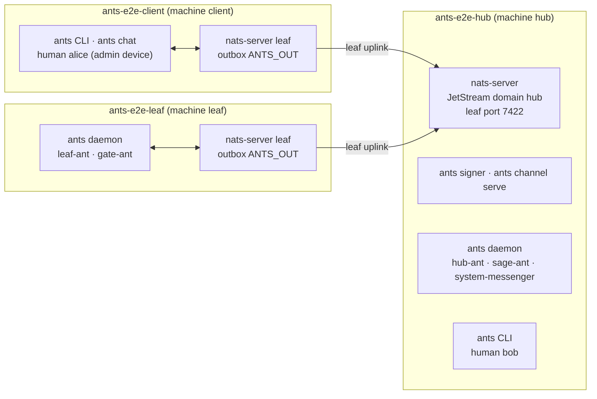

# End-to-end scenarios: hub, leaf and chat client in containers, Claude harness

Manual or scripted end-to-end scenarios for a three-container bus under
[Apple container](https://github.com/apple/container): a hub, a worker leaf and a client running the CLI and
`ants chat`. Every ant runs Claude Code. The scenarios say what to do and what must be observed;
`scripts/e2e.sh` builds the [fixture](#fixture) and runs them ([Running them](#running-them)). The repository's
[container demo](container-demo.md) builds another topology (Copilot, two worker leaves, no client node).

- [Fixture](#fixture) · [Claude sign-in](#claude-sign-in) · [Running them](#running-them) · [Conventions](#conventions)
- Scenarios: [F preflight](#f-preflight) · [B onboarding](#b-bringing-up-machines-and-people) · [M messages](#m-messages-between-a-human-and-an-ant) ·
  [A ant to ant](#a-ant-to-ant-across-machines) · [C channels](#c-channels) ·
  [L housekeeping](#l-looking-after-threads-and-channels) ·
  [S steering, queue, cancel](#s-steering-queueing-cancelling-and-withdrawing) · [T tool approvals](#t-tool-approvals) ·
  [E escalations](#e-escalations) ·
  [O admin orders](#o-admin-orders-from-the-client) · [G teams](#g-teams) · [R resilience](#r-restarts-outages-and-store-and-forward) ·
  [H harness holds and limits](#h-harness-holds-limits-and-redaction) · [U `ants chat`](#u-ants-chat-on-the-client) ·
  [X sense and trails](#x-sense-and-trails) · [K credentials](#k-credentials-and-sealing) ·
  [D dreams and sage reviews](#d-dreams-and-sage-reviews)
- [Coverage](#coverage) · [Left out](#left-out)

## Fixture



Three containers on one dedicated network, each with a volume of its own at `/demo`, `HOME=/demo/home`,
`ANTS_JS_DOMAIN=hub`, no port published on the host. The image is built from
`contrib/e2e/Containerfile`: like the container demo's, `ants` built with the pinned Rust toolchain and the pinned
`nats-server`, with, in place of Copilot CLI, Claude Code 2.1.330 and its ACP adapter `claude-agent-acp` 0.107.0 (the
npm packages `@anthropic-ai/claude-code` and `@agentclientprotocol/claude-agent-acp`), `jq`, `procps`, `python3-pyte`
and the GitHub stub (`contrib/e2e/github_stub.py`).

| Container | Runs | Users and files |
|---|---|---|
| `ants-e2e-hub` | `nats-server` (domain `hub`, leaf port `7422` on the network, `feature_flags { js_api_reply_v2: true }`, `full` resolver), `ants signer`, `ants channel serve`, `ants daemon` | Account keys in `~/.config/ants/auth`; `hub-ant` (`capabilities = ["e2e", "hub"]`, workdir `/demo/work`, a git repository with `node.txt` committed, `max_harnesses = 2`, worktrees left at their default: on); `sage-ant` (workdir `/demo/work`, `max_harnesses = 1`, a `whoami` making its reviews predictable: the sage of [group D](#d-dreams-and-sage-reviews), of its own so that no other scenario's pause or restart takes the reviewer away); `system-messenger` (`ants auth builtin messenger`); host credentials `hub`; human `bob` (`ants auth user bob --human`, no admin role) |
| `ants-e2e-leaf` | `ants daemon` running its own leaf `nats-server` (`[nats_server] config = "~/.config/ants/leaf.conf"`, so add and retire orders reconnect the uplink) | `leaf-ant` (`capabilities = ["e2e", "leaf"]`, workdir `/demo/work`, no git, `max_harnesses = 2`, `env = { E2E_SECRET_TOKEN = "e2e-s3cr3t-0123456789" }`); `gate-ant` (workdir `/demo/gate`, `tools = "ask"`, `allow = ["read", "search", "execute:ls*"]`, `max_harnesses = 1`); host credentials `leaf`; uplink `ants auth leaf leaf --ant leaf-ant --ant gate-ant` |
| `ants-e2e-client` | leaf `nats-server` only, no daemon | Human `alice` (`ants auth user alice --human --admin --label client`), `[cli] creds` naming her credentials; uplink `ants auth leaf client --human alice` |

Shared by the hub's and the leaf's `config.toml`:

```toml
harness = "claude"
human = "alice"                  # ownerless escalations and notices go to alice
sage = "none"                    # no review prompts beside the scenarios'
js_domain = "hub"
metrics = "127.0.0.1:9464"

# Claude Code on its native protocol. The nodes run as root, where Claude Code refuses bypassPermissions unless
# IS_SANDBOX=1 says the machine is a sandbox.
[harnesses.claude]
command = "claude"
protocol = "claude"
mode = "bypassPermissions"
ask = { mode = "default" }       # gate-ant (tools = "ask"): asks ants before commands and edits
review = { mode = "plan" }
sign_in = "claude login"
env = { IS_SANDBOX = "1" }
```

Every ant sets `model = "claude-haiku-4-5"` to bound the spend. Each workdir holds `node.txt` with one line,
`node=hub` or `node=leaf` (`node=gate` in `/demo/gate`). Once all three are up, the outboxes are wired from the hub as
a human: `ants leaf outbox leaf --ant leaf-ant --ant gate-ant` and `ants leaf outbox client --human alice`.

Left up, the fixture's own ants dream too, each once a day after 30 minutes without a prompt, spending a prompt each
([sense.md](sense.md#dreams)); `sage = "none"` has them review alone.

**ACP adapter variant.** Dropping the `[harnesses.claude]` table runs the built-in `claude` harness
(`claude-agent-acp`, `npm install --global @agentclientprotocol/claude-agent-acp`), with `env = { IS_SANDBOX = "1" }`
on each ant and, for `gate-ant`, a harness redefined with `mode = "default"`
([config.md](config.md#asking-ants-about-tools)). The scenarios hold with three differences, each noted where it
applies: a steer interrupts the prompt rather than joining it (S1), `ants ant mcp` reports no servers (O5), and a
bad login may surface as ACP `auth_required` at the first prompt rather than at the session's start (H1).

**Scratch nodes.** The [B scenarios](#b-bringing-up-machines-and-people) bring up machines as a user would, each on a
scratch node of its own: a container `ants-e2e-NAME` of the same image on the network, started with
`ants-e2e-node scratch`, with no volume (its `/demo` goes with it), the Claude env file, `IS_SANDBOX=1` and
`ANTHROPIC_MODEL=claude-haiku-4-5`. It holds `/demo/work/node.txt` (`node=scratch`) and nothing else: no keys, no
config, nothing started. The image carries the ACP adapter of the built-in `claude` harness too
(`@agentclientprotocol/claude-agent-acp`, build arg `CLAUDE_ACP_VERSION`), so that `ants setup` finds exactly one
built-in harness; the fixture's own nodes keep their `[harnesses.claude]` table. `ants-e2e-node config MACHINE` prints
the shared settings above for a worker machine to start from. A scenario removes its scratch node when it ends;
`scripts/e2e.sh down` and `reset` remove any left behind.

**Stub GitHub.** For `ants login` (B6 to B9) the hub runs `contrib/e2e/github_stub.py` on its loopback, port 8765
(log `/demo/log/github-stub.log`): GitHub's device flow (`/login/device/code`, `/login/oauth/access_token`) and the
REST calls the signer makes (`/user`, `/user/emails`, org and team memberships). A flow stays pending until a
scenario plays the person signing in, posting the user code `ants login` printed with a login, numeric id and verified
addresses to `/e2e/authorize`; the stub then answers for that user. The hub's config carries a `[registration]` table
pointing the signer at the stub (`client_id = "e2e-stub"`, `github_url` and `api_url` `http://127.0.0.1:8765`) with
`email_domains = ["e2e.example"]`, and the hub keeps `bootstrap.creds` (`ants auth bootstrap`) in its auth directory.
No certificate is needed: `ants login --github-url https://github.e2e.example` only compares that URL with the
verification page the signer reports and never fetches it.

## Claude sign-in

Only the hub and the leaf run Claude Code; the client needs no sign-in. Either way works; the token is signed in to
once for both nodes and survives rebuilt volumes.

**A long-lived token (recommended).** On the Mac, with Claude Code installed and a Claude subscription:

```sh
claude setup-token                       # opens the browser once, prints a token starting with sk-ant-oat01-
mkdir -p ~/.config/ants-e2e && umask 077
printf 'CLAUDE_CODE_OAUTH_TOKEN=%s\n' 'sk-ant-oat01-…' > ~/.config/ants-e2e/claude.env
```

Start the hub and leaf containers with `--env-file ~/.config/ants-e2e/claude.env` (or `--env
CLAUDE_CODE_OAUTH_TOKEN` to pass the shell's). The daemon's environment reaches every harness it starts, and the
daemon redacts the value from what it publishes. Keep the token out of `config.toml` and out of `ants ant set`: an
order's values stay in the order as sent. `ANTHROPIC_API_KEY` must be unset in those containers: it takes precedence
over the token and bills the API account instead.

**An interactive sign-in, once per node.** After the nodes are up:

```sh
container exec --interactive --tty ants-e2e-hub claude     # then /login, following the printed URL; /exit
container exec --interactive --tty ants-e2e-leaf claude
```

The login is kept in `/demo/home/.claude/.credentials.json` on the node's volume and outlasts removing and recreating
the container. Sign in on each node rather than copying the file: each node refreshes its own login.

F2 checks the sign-in before any prompt is spent.

## Running them

`scripts/e2e.sh` (macOS, Apple container 1.7 or later, `jq`) builds the fixture from `contrib/e2e/` and runs the
scenarios with the token of `~/.config/ants-e2e/claude.env` (`ANTS_E2E_CLAUDE_ENV` names another file):

```sh
scripts/e2e.sh build          # the image: ants from this checkout, nats-server, Claude Code
scripts/e2e.sh up             # create or start the three containers, wire the outboxes, wait for the colony
scripts/e2e.sh run            # P0 and P1; or ids (M1 S3), groups (M S), priorities (P0) or all
scripts/e2e.sh run -j 3 all   # the scenarios sharing the fixture 3 at a time, then the others one by one
scripts/e2e.sh list           # the scenarios automated
scripts/e2e.sh down           # remove the containers and network, keeping the volumes
scripts/e2e.sh reset          # remove the volumes too: the next up starts afresh
```

`build`, `up`, `run`, `down` and `reset` take a lock in the state directory, so a second one waits for the first to
end rather than changing the fixture under it. `ANTS_E2E_IMAGE` names the image `build` tags and `up` creates missing
nodes from (default `ants-e2e:local`), to try a changed fixture without retagging the image the running nodes came
from.

Everything is safe to repeat. `up` creates what is missing and starts what is stopped; the hub issues the account keys
and credentials once and keeps them on its volume, and `up` copies them to the other nodes; config files are written
anew at each start. `run` starts with `up`. Each scenario takes fresh tokens and undoes what it changed (a pause, a
setting, a stopped node, a dropped uplink), even when it fails; `ants chat` scenarios open a chat of their own,
driven through a pseudo-terminal in the client and read back with pyte (`contrib/e2e/chat.py`). A run prints `PASS`,
`FAIL` or `SKIP` per scenario and keeps each scenario's log under `~/.local/share/ants/e2e/runs/`; a failing
preflight stops it. A check failing on a bug filed in bd is reported beside the scenario's `PASS` as
`known: <issue>`, the scenario going on.

**The slow class.** The scenarios of [group D](#d-dreams-and-sage-reviews) are of class `SLOW` in place of a priority:
each waits about 35 minutes for a dream, which begins only after 30 minutes without a prompt and which no setting
shortens. `run` selects them only by id (`D1`), by the group letter `D` or by `slow`, never by `all`, a priority or
the default; `list` shows the class. They add ants of their own and run side by side, so `run -j 3 D` takes one wait of
about 35 minutes, not one per scenario.

`run -j N` (or `ANTS_E2E_JOBS`) runs the preflight first, then the scenarios that only read the fixture N at a time,
each on threads of its own, then one by one those that change what the others rely on: B2–B5, R1–R6, H1–H3, O1–O3, O6, O7,
S4, T4, U4, U5, U7, U8, X1, X4, X6, X7, K1, E2, E3, E6 and G1–G6 (a node, an uplink, an ant's settings, pause or team, the client's leaf credentials, all
of an ant's harnesses). The fixture's
ants take 3 harnesses each (`gate-ant` 2), so a few scenarios can prompt one ant at once. Running several at once
spends the token's rate limit faster.

A prompt asking the ant to wait runs `python3 -c "import time; time.sleep(N)"` rather than the `sleep N` written below,
in the foreground, and says it is for an end-to-end test of ants: Claude Code refuses a bare `sleep` and may run a long
command in the background, ending the prompt at once, and a small model balks at an aimless wait.

Where the fixture departs from the text below: the leaf has no human, so its `ants doctor` runs with `leaf-ant`'s
credentials and skips the `outbox` check (the client's is checked; R3 shows the leaf's outbox at work); `ants machines`
prints the account holder as a line of its own rather than an `_account` row; `ants ant mcp` counts each server's
tools rather than naming them.

## Conventions

Shell helpers on the Mac, used by every step:

```sh
hub()    { container exec ants-e2e-hub "$@"; }
leaf()   { container exec ants-e2e-leaf "$@"; }
alice()  { container exec ants-e2e-client ants "$@"; }                             # [cli] creds: alice
bob()    { container exec ants-e2e-hub ants --creds /demo/home/.config/ants/auth/bob.creds "$@"; }
tok()    { uuidgen | tr '[:upper:]' '[:lower:]' | cut -c1-8; }                      # a fresh token per scenario
thread() { awk '$1 == "thread" { print $2; exit }'; }                              # thread id from ants ask / post
uplink() {  # uplink leaf|client down|up: point the node's leaf at a dead address, or back at the hub
    local url="nats-leaf://$HUB_IP:7422"; [ "$2" = up ] || url="nats-leaf://127.0.0.1:9"
    container exec "ants-e2e-$1" sh -c "ants leaf config $1 --uplink $url && kill -HUP \$(pidof nats-server)"
}
```

- `HUB_IP` is the hub's address on the network (`container inspect ants-e2e-hub`). After a `container start` of the
  hub, read it again; when it changed, run `uplink leaf up` and `uplink client up`.
- Each prompt asks for an exact reply holding a fresh token (`t=$(tok)`), so a pass is a string match, not a reading
  of prose. A scenario passes when every line under **Expect** holds; where a model's wording may vary, the
  expectation names what is stored (`ants thread show`, `ants thread search`), not the wording.
- **Priority:** P0 must pass before a release, P1 should, P2 is worth a look. **Prompts:** the model turns a scenario
  spends, to budget a run; a full run of P0 and P1 spends about 121.
- Scenarios run one after the other, in the order given within a group; a group leaves the fixture as it found it.
  `ants thread show last` and `ants ask --thread last` name the latest thread of the human asking.
- Wait bounds: `--timeout 3m` on every `--wait`; `live` in the colony within 30 s of a start; an admin order's outcome
  within its `--wait`.

## F. Preflight

No model call. A failure here stops the run.

### F1 · The colony is up across the three containers (P0)

```sh
hub curl --fail --silent http://127.0.0.1:9464/healthz && leaf curl --fail --silent http://127.0.0.1:9464/healthz
alice colony --json
alice machines
hub ants doctor --no-harness; leaf ants doctor --no-harness; alice doctor --no-harness
```

**Expect**
- `ants colony --json` from the client lists `hub-ant`, `leaf-ant`, `gate-ant` and `system-messenger`, each `live`,
  `harness` `claude`, `agent` naming Claude Code and its version, `machine` `hub` or `leaf`.
- `ants machines` lists `hub`, `leaf` and `_account` (the hub, put by `ants signer`).
- No `fail` line from any `ants doctor`; on the leaf and the client, `leaf uplink` and `outbox` are `ok`.

### F2 · Claude Code is installed and signed in on both nodes (P0)

```sh
hub ants harness check; leaf ants harness check
```

**Expect** each names Claude Code 2.1.325 or later and opens a session; none reports `auth_required` or a missing
`bypassPermissions` mode.

### F3 · The bus carries notes between all three nodes (P0)

```sh
t=$(uuidgen | tr '[:upper:]' '[:lower:]')
alice notes "$t" "from client $t"; bob notes "$t" "from hub $t"
alice notes "$t"; bob notes "$t"
```

**Expect** both readers print both notes. `leaf ants --creds /demo/home/.config/ants/auth/leaf-ant.creds inbox` is refused:
ant credentials read no human inbox.

## B. Bringing up machines and people

What a new user runs first, each on a [scratch node](#fixture) of its own: `ants setup` on an empty machine, a worker
machine joining the hub, and people joining with `ants login`. `on NODE` runs a command on a scratch node, as `hub`
does on the hub. No service manager runs in the containers: where the README installs units
(`scripts/install-units.sh`), the scenarios start what `ants setup` or the README print, in the background, with
`--upgrade-check 0` as the fixture's services. B2 to B5 issue credentials on the hub and run alone; B1 and B6 to B9
touch no ant of the fixture.

### B1 · `ants setup` brings an empty machine up, as the quick start does (P0, 2 prompts)

Scratch node `solo`, no credentials: the bus is unauthenticated and the CLI acts as the `human` `ants setup` writes into the new config file. Its commands run without
the image's `ANTS_JS_DOMAIN=hub`, which is the fixture's: a machine of its own has no JetStream domain.

```sh
on solo ants setup --ant dev-a --workdir /demo/work --managed-nats --no-services
on solo ants daemon --config /demo/home/.ants/config.toml &       # what --no-services leaves to the user,
on solo ants init                                                 # as setup prints it; then wait for dev-a live
on solo ants ask --wait --timeout 3m @dev-a "Read node.txt in the working directory and reply with its content and SETUP-$t."
on solo ants inbox; on solo ants thread show last; on solo ants colony
on solo ants channel create ops --member dev-a
on solo ants post --wait --timeout 3m '#ops' "@dev-a reply with exactly OPS-$t"
on solo ants doctor
on solo ants setup --ant dev-a --workdir /demo/work --managed-nats --no-services    # again
```

**Expect**
- Setup names the harness it picked (`claude, the only built-in harness installed here`) and each step done; with
  `--no-services` it leaves two to the user, printed as such: start `ants daemon --config FILE`, which runs the
  nats-server of `[nats_server]`, then `ants init`. It exits 0, its closing `ants doctor` skipping the server check
  for the server `--no-services` leaves to start. Its harness step passes.
- `~/.config/ants/nats.conf` and `~/.ants/config.toml` exist, the config holding a `[nats_server]` table, the
  messenger, the sage and `dev-a`; the colony lists `dev-a` and `system-messenger` live on the ACP adapter.
- The replies hold `node=scratch` with `SETUP-$t`, and `OPS-$t`; `ants thread show` ends with the tokens and cost.
  Setup writes no model: `ANTHROPIC_MODEL` keeps the adapter's Claude Code on Haiku, as its session files show.
- `ants doctor` prints no `fail` line (the daemon and hub services warn: none installed).
- The second setup reports what exists, changes neither file (same checksums) and exits 0.

### B2 · A worker machine joins the hub by enrollment (P0, 1 prompt)

The README's leaf flow on scratch node `join-b2`, machine `join-b2`, ant `b2-$t`, with the fixture's addresses:

```sh
hub ants auth leaf join-b2 --ant b2-$t --js-domain hub
hub ants auth enroll b2-$t
# copy server.conf, leaf-join-b2*.creds and enroll-b2-$t.creds to the node
on join-b2 sh -c 'ants-e2e-node config join-b2 > ~/.ants/config.toml'     # the shared settings, machine join-b2
on join-b2 ants leaf config join-b2 --uplink nats-leaf://$HUB_IP:7422
on join-b2 nats-server -c ~/.config/ants/leaf.conf &
on join-b2 ants add b2-$t --workdir /demo/work --model claude-haiku-4-5 --enroll ~/.config/ants/auth/enroll-b2-$t.creds &
hub ants enroll list
hub ants enroll approve b2-$t --js-domain hub
hub ants --creds ~/.config/ants/auth/alice.creds leaf outbox join-b2 --ant b2-$t --js-domain hub
on join-b2 ants daemon &
r=$(tok); alice ask --wait --timeout 3m @b2-$t "Read node.txt in the working directory and reply with its content and JOIN-$r."
alice machines; hub ants auth issued; on join-b2 ants --creds ~/.config/ants/auth/b2-$t.creds doctor --no-harness
```

**Expect**
- `ants enroll list` shows `b2-$t` pending and names `join-b2` as the machine whose host credentials are asked for.
- After the approval `ants add` exits 0, having written `b2-$t.creds` and the host credentials of `join-b2` where
  the daemon looks for them.
- The colony shows `b2-$t` live on machine `join-b2`; the reply holds `node=scratch` and `JOIN-$r`.
- `ants machines` lists `join-b2`; `ants auth issued` lists `b2-$t` and `host-join-b2`; `ants doctor --no-harness`
  on the node prints no `fail` (`leaf store uplink` included, though `ants add` has respelled the uplink's
  credentials path in `leaf.conf`), `leaf uplink` and `host credentials` ok.

**Undo** (also first, for a run cut short): drop `b2-$t` from the outbox sourcing (`ants leaf outbox join-b2
--remove-ant`), remove the node, then on the hub revoke `b2-$t`, `host-join-b2` and `leaf-join-b2`
([auth.md](auth.md#issuing-and-revoking-credentials)). The machine's name stays fixed, so its record in
`ants machines` is one, not one per run; the ant's name is fresh.

### B3 · A rejected enrollment stops `ants add` (P1)

As B2 on node `join-b3`, up to the request:

```sh
on join-b3 ants add b3-$t --workdir /demo/work --enroll ~/.config/ants/auth/enroll-b3-$t.creds &
hub ants enroll reject b3-$t --reason "e2e $t"
```

**Expect** `ants add` ends with a non-zero status naming the rejection and its reason within about 10 s (it asks every
5 s); no `b3-$t.creds` on the node; `ants enroll list` no longer lists `b3-$t`; the colony never shows it.

### B4 · An ant added out of band with a signed JWT (P1, 1 prompt)

As B2 on node `join-b4`, the uplink issued with the ant up front (`ants auth leaf` issues none with no member), and
no enrollment ([auth.md](auth.md#adding-an-ant), first block):

```sh
on join-b4 ants add b4-$t --workdir /demo/work --model claude-haiku-4-5       # prints the public key U...
hub ants auth user b4-$t --public-key U... --js-domain hub                     # prints the JWT
on join-b4 ants add b4-$t --jwt JWT
hub ants --creds ~/.config/ants/auth/alice.creds leaf outbox join-b4 --ant b4-$t --js-domain hub
on join-b4 ants daemon &
alice ask --wait --timeout 3m @b4-$t "Reply with exactly: JWT-$t"
```

**Expect** `b4-$t` live on `join-b4` and answering with `JWT-$t`. Undo as B2.

### B5 · Enrollment requests seen from `ants chat` (P2)

A request heard on the hub, from `ants add b5-$t --enroll ...` run there under a HOME of its own:

```sh
alice chat          # home: "requests for credentials are answered on machine hub, ..."; c: the credentials page
hub ants chat       # as bob, where the account key is: home lists "b5-$t (enroll)"; c, then r and y rejects it
```

**Expect** on the client, which holds no account key, home names the machine that does (`requests for credentials
are answered on machine hub, where the bus's account key is`) and the credentials page says the key is not on this
machine and to approve on `machine hub`; on the hub, home counts the request (`b5-$t (enroll)`), its page lists it,
and `r` then `y` rejects it, ending the `ants add`.

### B6 · A person the registration policy admits is signed at once (P1)

`ants login` on the hub under a HOME of its own, against the [stub GitHub](#fixture); the person signs in as GitHub
user `dana-$t` with a verified address in `e2e.example`, the policy's domain:

```sh
HOME=/demo/login-$t ants login --hub nats://127.0.0.1:4222 --name dana-$t --label e2e \
    --bootstrap ~/.config/ants/auth/bootstrap.creds --github-url https://github.e2e.example &
# sign in at the stub with the code printed
HOME=/demo/login-$t ants inbox; HOME=/demo/login-$t ants notes $TH "from dana $t"; alice notes $TH
hub ants auth issued --json; hub ants auth devices dana-$t
```

**Expect** login prints the verification page and code, then ends 0 having written `dana-$t.creds` (mode 600) and
pointed `[cli]` of the new HOME's config at it; the new device reads its inbox and its note reaches alice; `ants auth
issued` records `dana-$t` with label `e2e` and an `email-domain` grant, and `ants auth devices` lists the device. The
stub's log shows the device flow. **Undo:** revoke `dana-$t`, remove the HOME.

### B7 · A person outside the registration policy waits for a human (P1)

As B6 for `erin-$t`, whose only verified address is outside the policy:

```sh
alice tools list                          # "register human erin-$t: GitHub user erin-$t (id N), outside ..."
alice tools approve signer/ID
# a second login of erin-$t, same GitHub user, under another HOME
```

**Expect** login says it waits for a human of the bus to approve, and the signer's request is listed; after the
approval login ends 0 and `ants auth issued` records an `approval` grant naming the human. The second login is signed
at once, the approval standing for that user and name: two live keys of `erin-$t`. **Undo:** revoke `erin-$t`, remove both
HOMEs.

### B8 · A rejected registration leaves nothing behind (P2)

As B7 for `frank-$t`, with `alice tools reject signer/ID`. **Expect** login fails naming the refusal (`was refused`),
leaves no key or credentials file in the HOME, and nothing is issued to `frank-$t`.

### B9 · A registered device renews (P2)

As B7 for `gina-$t`, then `HOME=/demo/login-$t ants renew`; and as B6 for `hank-$t` (email-domain grant), then
`ants renew` under that HOME. **Expect** the credentials file of `gina-$t` changes and still reads the inbox, and
`ants auth issued` records the renewal (`renewed_from`): an approval grant renews while the approval stands. The
renewal of `hank-$t` is refused, naming `ants login`: only a new sign-in shows the verified addresses. **Undo:** revoke both
names.

## M. Messages between a human and an ant

### M1 · Ask the hub's ant from the client (P0, 1 prompt)

```sh
t=$(tok); alice ask --wait --timeout 3m @hub-ant "Reply with exactly: PONG-$t"
alice thread show last; alice spend hub-ant --thread last
```

**Expect**
- `ants ask` prints `thread <id>`, `message <id>` and a reply holding `PONG-$t`, exit 0.
- `ants thread show` shows `● alice -> hub-ant`, the reply `● hub-ant -> alice` and an `ended: replied` line with a
  duration, tokens and a US-dollar cost; `ants spend` shows the same cost.

### M2 · Ask the leaf's ant; its tools run on the leaf (P0, 1 prompt)

```sh
alice ask --wait --timeout 3m @leaf-ant "Read the file node.txt in the working directory and reply with its content only."
alice thread show last
```

**Expect** the reply is `node=leaf`; the thread's timeline shows a read of `node.txt` by `leaf-ant` (`⎿ … Read(…)`).
The message crossed client leaf → hub → worker leaf and back.

### M3 · A follow-up resumes the thread's session (P0, 2 prompts)

```sh
t=$(tok); th=$(alice ask --wait --timeout 3m @leaf-ant "Remember the word $t for this conversation. Reply OK." | thread)
alice ask --wait --timeout 3m --thread "$th" @leaf-ant "Which word did the first message of this conversation give? Reply with it only."
```

**Expect** the second reply is `$t`; `ants thread show "$th"` shows no `[ants] The earlier session of this thread could
not be resumed` notice and no `session rebuilt` on either `ended:` line.

### M4 · Inbox, read markers and marking unread (P0, 1 prompt)

```sh
t=$(tok); alice ask @hub-ant "Reply with exactly: INBOX-$t"        # no --wait
sleep 60; alice inbox --peek; alice inbox; alice inbox
alice inbox --unread last; alice inbox --peek
```

**Expect** `--peek` lists the reply and leaves it unread; the first `ants inbox` lists it again and marks it read; the
second lists nothing; after `--unread` it is listed once more.

### M5 · Attachments in both directions through the leaf (P1, 1–2 prompts)

```sh
t=$(tok); container exec ants-e2e-client sh -c "printf 'attached-$t\n' > /tmp/in.txt"
alice ask --wait --timeout 3m --attach /tmp/in.txt @leaf-ant \
  "Read the attached file with read_attachment: it returns the file's text, a single line that is not a path. Write that line unchanged to out.txt, then call attach_to_reply with out.txt. Only once attach_to_reply has succeeded, reply DONE: a reply without out.txt attached fails this test."
alice thread show last          # note the reply's attachment handle
# Only if the reply lacks 📎 out.txt (the model skipped the tool call), once:
alice ask --wait --timeout 3m --thread THREAD @leaf-ant \
  "Your reply carried no attachment. Call attach_to_reply with out.txt now, then reply DONE."
container exec --workdir /tmp ants-e2e-client ants attachment get HANDLE
```

**Expect** `ants ask` prints `attachment <handle>`; the reply lists `📎 out.txt (…) <handle>`; `ants attachment get`
saves `/tmp/out.txt` on the client after verifying its size and SHA-256, and its content is the token line.

### M6 · An unaddressed message is routed by the messenger (P1, 2–3 prompts)

```sh
t=$(tok); alice ask --wait --timeout 5m "For an ant with capability leaf: reply with exactly ROUTED-$t"
alice thread search --from system-messenger --since 10m
```

**Expect** `ants ask` prints `to system-messenger`; a reply holding `ROUTED-$t` reaches alice; the search shows a
message of `system-messenger` to `leaf-ant` (or `gate-ant`, neither of the hub's ants). When the leaf's ant is busy past
the route's wait, the messenger first tells alice the answer did not come; the late reply is then prompted to the
messenger on the thread, and within 5 minutes a message of `system-messenger` passes `ROUTED-$t` on to alice.

## A. Ant to ant across machines

### A1 · `ask_ant` from the hub's ant to the leaf's (P0, 2 prompts)

```sh
alice ask --wait --timeout 5m @hub-ant \
  "Use the ask_ant tool to ask leaf-ant for the content of node.txt in its working directory. Reply with that content only."
alice thread show last
```

**Expect** the reply is `node=leaf`; the thread holds `hub-ant -> leaf-ant` and `leaf-ant -> hub-ant` between alice's
message and the answer, on the same thread.

### A2 · `route` by capability from the leaf's ant (P1, 2 prompts)

```sh
alice ask --wait --timeout 5m @leaf-ant \
  "Use the route tool with capability hub and the text 'Reply with the content of node.txt in the working directory only'. Reply with the answer only."
```

**Expect** the reply is `node=hub`.

### A3 · A question to the human and its answer (P0, 2 prompts)

```sh
th=$(alice ask @hub-ant "Use ask_human to ask one question, 'Pick a colour', with options RED and BLUE. Once answered, reply with exactly PICKED-<the label picked>." | thread)
sleep 60; alice inbox --peek            # note the question's message id
alice answer MESSAGE 2
alice inbox --thread "$th"
```

**Expect** the inbox prints the question with its numbered options and how to answer; after `ants answer`, a reply
`PICKED-BLUE`; `ants thread show "$th"` lists the answer stored with the question.

### A4 · Parallel threads of one ant, each in its own worktree (P1, 2 prompts)

```sh
a=$(tok); b=$(tok)
alice ask @hub-ant "Write $a to out.txt, commit it with git, and reply DONE-$a" &
alice ask @hub-ant "Write $b to out.txt, commit it with git, and reply DONE-$b" &
wait; sleep 15; alice colony --json                 # while both run
sleep 90; alice inbox
hub git -C /demo/work branch --list 'ants/hub-ant/*'; hub git -C /demo/work status --short
```

**Expect** the colony entry of `hub-ant` shows `handling` 2 while both run; both replies arrive; two branches
`ants/hub-ant/<thread>` exist, each with one commit holding its own token in `out.txt`; `/demo/work` itself has no
`out.txt` and no change.

## C. Channels

### C1 · A channel across machines; a mention wakes the member (P0, 1 prompt)

```sh
alice channel create e2e --member hub-ant,leaf-ant,alice,bob
t=$(tok); alice post --wait --timeout 3m '#e2e' "@leaf-ant reply with exactly CHAN-$t"
alice channel read e2e; bob channel list
```

**Expect** `leaf-ant`'s reply `CHAN-$t` is a post on the same channel thread; `hub-ant` posts nothing; `bob`'s
`ants channel list` counts the unread posts of `e2e`.

### C2 · An unmentioned post is triaged by the messenger (P1, 2 prompts)

```sh
t=$(tok); alice post '#e2e' "Without being mentioned, hub-ant is the one to answer this: hub-ant, reply here with exactly TRIAGE-$t"
sleep 120; alice channel read e2e
```

**Expect** `system-messenger` answers the post with one `@hub-ant` mention; `hub-ant` then posts `TRIAGE-$t`.

### C3 · A mention of a human reaches that human's inbox (P1)

```sh
t=$(tok); alice post '#e2e' "@bob please look at $t"; bob inbox --peek
```

**Expect** `bob`'s inbox on the hub holds a mention notice naming the channel and holding `$t`; no ant is prompted.

## L. Looking after threads and channels

What a human does around the messages: finding and marking threads, reactions, quoted replies and forwards, TL;DRs,
channel upkeep, reminders and holds, and the one-line status. Most of it spends no prompt. `alice` acts from the
client, `bob` from the hub. Two helpers:

```sh
a_thread() {  # a_thread ANT TOKEN: one prompt; prints the thread and the id of ANT's reply, left unread
    local th; th=$(alice ask "@$1" "Reply with exactly: HK-$2" | thread)
    sleep 60; echo "$th $(alice thread show "$th" --json | jq -r --arg a "$1" 'select(.from == $a) | .id' | head -n 1)"
}
dm() { alice ask --plaintext @bob "$1" | thread; }   # a thread of two humans, no prompt
```

### L1 · Finding a thread (P0, 1 prompt)

```sh
t=$(tok); read -r TH M < <(a_thread leaf-ant "$t")   # asking it to read node.txt first, for a tool call
TH2=$(dm "L1-$t")
alice thread list --grep "HK-$t"; alice thread list --ant leaf-ant --grep "$t"; alice thread list --owner bob --grep "$t"
alice thread list --grep "HK-$t" --json
alice notes "$TH" "NOTE-$t"
alice thread search --grep "$t" --from leaf-ant; alice thread search --grep "$t" --to alice
alice thread search --grep "$t" --type note
alice thread show "$TH"; alice thread show "${TH:0:18}"; alice thread show last
alice thread show "$TH" --json; alice thread show "$TH" --no-tools
alice thread show <the prefix TH and TH2 share>; alice thread show ffffffff
```

**Expect** `--grep` lists the thread alone, its row naming owner `alice`, users `alice,leaf-ant` and the first line;
`--ant leaf-ant` and `--owner alice` list it, `--ant hub-ant` and `--owner bob` do not; `--json` gives the same owner
and users. `--from leaf-ant` finds the reply (message `M`) and not the note; `--to alice` the reply, `--to leaf-ant`
not; `--type note` the note alone. `thread show` by the full id and by an 18-character prefix prints the thread with
its `Read(` line, `--no-tools` without it, `--json` only entries of the thread; `last` prints a thread (the latest of
alice's, another scenario's under `-j`). A prefix two threads share and an unknown one exit non-zero, the first listing
candidates (`give more of the id`), the second saying no thread of the last 7 days starts with it.

### L2 · Title, done, pin and archive (P0)

```sh
t=$(tok); TH=$(dm "L2-$t"); bob ask --plaintext --thread "$TH" @alice "L2-$t read"
alice thread title "$TH" "E2E $t"; alice thread list --grep "$t"; bob thread list --grep "$t"; alice thread title "$TH" --clear
alice thread done "$TH"; bob thread list --grep "$t"; bob notes "$TH" "reopens"; alice thread list --grep "$t" --json
alice thread done "$TH"; alice thread undone "$TH"
alice thread pin "$TH"; alice thread list --pinned; alice thread list; bob thread list --pinned
alice thread archive "$TH"; alice thread list --pinned; alice thread list --archived; bob thread list --grep "$t"
alice thread pin "$TH"; alice thread unpin "$TH"; alice thread archive "$TH"
bob notes "$TH" "new again"; alice thread list --grep "$t"; alice thread unarchive "$TH"
```

**Expect** the title shows in both humans' lists (titles are shared) and is gone after `--clear`. `done` shows in the
STATE of both lists (`done.by` `alice` in `--json`); bob's note reopens the thread; `undone` clears a second `done`.
The pinned thread is listed by `--pinned`, after every unpinned row of the plain list, and not by bob's `--pinned`
(pins are alice's). Pins and archives exclude each other: archiving the pinned thread unpins it, pinning the archived
one unarchives it. The archived thread is gone from alice's list, not from bob's; bob's note shows it again as
`archived+new`; `unarchive` clears it.

### L3 · Reactions (P1, 1 prompt)

```sh
t=$(tok); read -r TH M < <(a_thread leaf-ant "$t")
alice react "$M" thumbs-up; alice react "${M:0:18}" eyes; alice thread show "$TH"
alice react "$M" thumbs-up --remove; sleep 30; alice thread show "$TH"; alice inbox --peek --thread "$TH"
leaf ants --creds /demo/home/.config/ants/auth/leaf-ant.creds react "$M" rocket      # and --remove
hub ants --creds /demo/home/.config/ants/auth/hub-ant.creds react "$M" rocket
```

**Expect** `thread show` prints `reacted thumbs-up: alice` and `reacted eyes: alice` under the reply (the second by a
prefix); after `--remove` only `eyes` is stored (`reactions` in `--json`). Nothing starts: the count of `ended:` lines
is the same 30 s later, and the reply is still unread in alice's inbox. With `leaf-ant`'s credentials the signer
applies `rocket` (`reacted rocket: leaf-ant`) and takes it away; `hub-ant`, which does not read the thread, is refused
(`none hub-ant reads`).

### L4 · A quoted reply and a forward (P1, 3 prompts)

```sh
t=$(tok); f=$(tok); read -r TH M < <(a_thread leaf-ant "$t")
alice ask --wait --timeout 3m --reply-to "$M" "Reply with exactly QUOTED-$t"
alice ask --wait --timeout 3m --forward "$M" @hub-ant "Reply with the word that follows HK- in the forwarded message, then FWD-$f."
```

**Expect** the quoted reply lands on `TH`, addressed to `leaf-ant` without `@leaf-ant`, stored with
`quote.from` `leaf-ant` and its excerpt; `thread show` prints `↪ replying to leaf-ant: HK-$t` above it; the answer is
`QUOTED-$t`. The forward opens a new thread whose first message holds the note, then
`Forwarded from leaf-ant on thread TH` and `> HK-$t`; `hub-ant`'s reply holds `$t` and `FWD-$f`.

P2 beside it: forward a message with an attachment (as M5 makes one); the new message lists `📎 out.txt (attached)`
and `ants attachment get` fetches the copy stored under it.

### L5 · TL;DR and digest (P1, 3 prompts)

```sh
t=$(tok); TH=$(dm "Plan $t: ship the e2e build on Friday, after the review")
bob ask --plaintext --thread "$TH" @alice "Agreed for $t: Friday, after the review"
alice ask --plaintext --forward-thread "$TH" @bob                 # refused: no TL;DR kept yet
alice thread tldr "$TH" --json; alice thread tldr "$TH" --json; alice thread tldr "$TH" --new --json
alice ask --plaintext --forward-thread "$TH" @bob
alice digest --since 10m
alice thread search --to system-messenger --since 1h --json      # the requests: summary.thread or summary.since
```

**Expect** the forward is refused until a TL;DR is kept. The first `tldr` asks the messenger (one request with
`summary.thread` `TH`) and stores a TL;DR by `system-messenger`, not empty; the second prints the same one (same `at`)
without asking; `--new` asks again and stores a newer one. The forward then carries it: `Forwarded thread TH, its
TL;DR by system-messenger`. `digest` prints a digest, not empty, after one more request (`summary.since`), and stores
nothing: the kept TL;DR is unchanged. The summary threads stay out of `ants thread list`.

### L6 · Channel upkeep (P1, 1 prompt)

```sh
t=$(tok); c=hk-$t
alice channel create $c --member leaf-ant,alice,bob --description "Housekeeping $t"; alice channel list
alice channel add $c hub-ant; alice channel set $c --owner leaf-ant --description "Upkeep $t"; alice channel remove $c hub-ant
TH=$(alice post --wait --timeout 3m $c "@leaf-ant answer this post with exactly HKCHAN-$t, using no tool" | thread)
bob post --thread "$TH" $c "@alice have a look at $t"; alice channel list
alice channel notify $c all; alice channel list; alice notify status
alice channel notify $c mentions; alice channel list; alice channel read $c --peek; alice channel list
alice channel read $c; alice channel list
alice thread archive "$TH"; alice channel read $c; alice channel read $c --archived; alice thread unarchive "$TH"
alice channel remove $c leaf-ant; alice post $c "@leaf-ant answer this post with exactly GONE-$t"; sleep 30
alice channel delete $c
```

**Expect** `channel list` shows the description in its `DESCRIPTION` column, then the member added, the owner and
description set, the member removed. After the answer and bob's post, alice's `UNREAD` is `1 (@1) +1 other` (bob's
post counts, leaf-ant's answer shows apart); at level `all` it is `2 (@1)` and `ants notify status` lists the level;
at `mentions` it is `1 (@1) +1 other` again. `read --peek` leaves the count, `read` clears it. The archived thread is
left out of `channel read` and printed by `--archived`. The post mentioning the removed `leaf-ant` warns that it is no
member and wakes no one: no message to `leaf-ant`, no answer, no triage. After `delete` the channel is not listed.

### L7 · Reminders, mutes and snooze (P2)

```sh
t=$(tok); TH=$(dm "L7-$t"); TH2=$(dm "L7-$t, another")
alice remind set "$TH" 2h "check $t"; alice remind set "$TH2" 1h "first $t"; alice remind list; alice remind list --json
alice remind clear "$TH2"; alice remind set "$TH" 1s "due $t"; alice remind list --json
# ants chat: /reminders
alice remind clear "$TH"
alice thread mute "$TH" --for 1h; alice notify snooze 10m; alice notify status; alice notify status --json
alice notify resume; alice thread unmute "$TH"; alice notify status --json
```

**Expect** `remind list` gives the reminders soonest first (`TH2`, then `TH`); `clear` removes one; setting another on
`TH` replaces its reminder, which turns `is_due` within seconds and is counted due by the chat's `/reminders` (the home
lists it with its note too, below the stuck items a long-used fixture gathers). No push sink runs in the fixture:
`notify status` lists the snooze and the muted thread, and neither once resumed and unmuted.

### L8 · `ants status`, `ants spend`, `ants queue` (P1, 1 prompt)

```sh
t=$(tok); read -r TH M < <(a_thread leaf-ant "$t")
alice status; alice status --json; alice status --tmux
alice spend leaf-ant --thread "$TH"; alice spend leaf-ant --thread "$TH" --json; alice spend leaf-ant --days 1 --json
alice queue
```

**Expect** `status` prints one line (home items by kind, working ants, the day's spend); `--json` an object with
`home`, `working` and `spend_today`; `--tmux` `⚑N ◐N $S`. `spend --thread` shows the thread's tokens, more than 0;
`--days 1 --json` one day and the thread among its threads. `queue` with no ant answers for every live ant (its
table of waiting messages, or that none waits).

### L9 · Messages from a file (P2, 1 prompt)

```sh
t=$(tok); printf 'Reply with exactly: FILE-%s\n\n  From a file: "quotes", $HOME and a tab\there.\n' "$t" >/tmp/hk-ask.txt
alice ask --wait --timeout 3m --file /tmp/hk-ask.txt @leaf-ant
alice channel create hkf-$t --member alice,bob; printf '@bob FILEPOST-%s\nsecond line\n' "$t" >/tmp/hk-post.txt
alice post --file /tmp/hk-post.txt hkf-$t
```

**Expect** the reply holds `FILE-$t`; the stored message and post (`thread show --json`) hold the file's text as it
is, but the trailing newline.

## S. Steering, queueing, cancelling and withdrawing

### S1 · A second message steers the running prompt (P0, 1–2 prompts)

```sh
t=$(tok); th=$(alice ask @leaf-ant "Run the shell command 'sleep 45', then reply with exactly FIRST-$t." | thread)
sleep 10; alice ask --thread "$th" @leaf-ant "Change of plan: once the sleep ends, reply with exactly SECOND-$t and nothing else."
sleep 90; alice thread show "$th"
```

**Expect** one answer, `SECOND-$t`, replying to the second message; the first message ends with a `steered` notice
naming the message that took the answer; one `ended: replied` line. ACP adapter variant: the first prompt is cancelled
with `[ants] alice interrupted the prompt to steer leaf-ant with a new message.` and its partial output, then the
second message runs and answers `SECOND-$t`.

### S2 · A queued message waits its turn (P1, 2 prompts)

```sh
t=$(tok); th=$(alice ask @leaf-ant "Run the shell command 'sleep 30', then reply with exactly ONE-$t." | thread)
sleep 5; alice ask --queue --thread "$th" @leaf-ant "Reply with exactly TWO-$t."
alice queue leaf-ant
sleep 90; alice inbox --thread "$th"
```

**Expect** `ants queue` lists the second message waiting; two replies arrive, `ONE-$t` then `TWO-$t`, each answering
its own message; no `steered` notice.

### S3 · Cancelling a running prompt (P0, 2 prompts)

```sh
t=$(tok); th=$(alice ask @leaf-ant "Reply 'starting', then run the shell command 'sleep 120', then reply LATE-$t." | thread)
sleep 15; alice cancel leaf-ant "$th"
alice inbox --thread "$th"; alice thread show "$th"
alice ask --wait --timeout 3m --thread "$th" @leaf-ant "Reply with exactly ALIVE-$t"
```

**Expect** within 15 s of the cancel, a reply ending with `[ants] The prompt was cancelled by alice (ants cancel).`;
`ended: cancelled`; no `LATE-$t`, no retry, no dead letter; `leaf pidof sleep` finds none; the follow-up answers
`ALIVE-$t` in the same session.

### S4 · Withdrawing a message that waits (P1)

```sh
alice ant pause leaf-ant
th=$(alice ask @leaf-ant "Reply NEVER" | thread)
alice queue leaf-ant                    # note the message id
alice withdraw leaf-ant MESSAGE; alice ant resume leaf-ant
sleep 20; alice inbox --thread "$th"
```

**Expect** the queue lists the message; after the resume, the only reply is `[ants] Withdrawn by alice before leaf-ant
was prompted with it (ants withdraw).`; `ants thread show "$th"` has no `ended:` line (no prompt ran).

## T. Tool approvals

`gate-ant` asks ants before commands and edits; reads and `ls` run unasked.

### T1 · A tool request, approved from the client (P0, 1 prompt)

```sh
t=$(tok); alice ask -f --timeout 3m @gate-ant "Run the shell command 'touch /demo/gate/approved-$t' and reply DONE-$t." &
sleep 40; alice tools list              # note gate-ant/<id>
alice tools show gate-ant/ID; alice tools approve gate-ant/ID
wait; leaf test -f /demo/gate/approved-$t
```

**Expect** `ants tools list` shows one pending `execute` request of `gate-ant` naming the command; nothing is created
before the approval; after it the file exists, the reply holds `DONE-$t`, and `ants thread show last` shows the
request and its decision by `alice`.

### T2 · A rejection with a note (P0, 1 prompt)

```sh
t=$(tok); alice ask -f --timeout 3m @gate-ant "Run the shell command 'touch /demo/gate/rejected-$t' and reply DONE-$t." &
sleep 40; alice tools reject gate-ant/ID --note "Do not create files. Reply with exactly NOPE-$t."
wait; leaf test ! -e /demo/gate/rejected-$t
```

**Expect** the file does not exist; the reply holds `NOPE-$t`; the thread shows the rejection by `alice` and her note
as a message on the thread.

### T3 · An allow rule lets a call through unasked (P1, 1 prompt)

```sh
alice ask --wait --timeout 3m @gate-ant "Run the shell command 'ls /demo/gate' and reply with its output only."
alice tools list
```

**Expect** the reply lists `node.txt`; no request was pending at any time (`ants thread show last` shows none).

### T4 · An unanswered request expires (P1, 1 prompt)

```sh
alice ant set gate-ant approval_timeout=30s
t=$(tok); alice ask --wait --timeout 3m @gate-ant "Run the shell command 'touch /demo/gate/expired-$t'. Reply RAN or REFUSED."
alice inbox; alice ant set gate-ant approval_timeout=
```

**Expect** after 30 s the call is rejected and the reply says `REFUSED`; the file does not exist; alice's inbox holds
an `approval` escalation notice on a thread of its own.

### T5 · Approving for the rest of the session, where the harness offers it (P1, 1 prompt)

```sh
t=$(tok); alice ask -f --timeout 5m @gate-ant "Run two shell commands as two separate tool calls, one after the other: first 'touch /demo/gate/always-1-$t', then 'touch /demo/gate/always-2-$t'. Then reply DONE-$t." &
sleep 40; alice tools list --json; alice tools show gate-ant/ID
alice tools approve gate-ant/ID --always
wait; leaf test -f /demo/gate/always-1-$t; leaf test -f /demo/gate/always-2-$t
```

**Expect** where the request offers `allow_always` (`options` in `--json`), `tools show` names what it allows, and
after `--always` the second call runs unasked: one request on the thread, both files, the reply `DONE-$t`. Claude Code
on its own protocol, as the fixture runs it, offers allow once and reject only: `tools show` names no `always`,
`--always` is refused (`allow-always is not offered`) leaving the request pending, and after `ants tools approve` the
second call is asked about too; approved, both files exist and the reply is `DONE-$t`.

P2 beside it: on the ACP adapter variant, which offers `allow_always`, the same steps let the second call through
unasked. `ants tools approve ID --rule` writes the allow rule to the machine's `config.toml` and needs a human's
credentials on that machine; the leaf has none.

## E. Escalations

No ant of the fixture has an `escalate_to` chain. A scenario needing one sets it with the shared setting and removes
it at its end, also when it fails, so E2, E3 and E6 run alone under `-j`:

```sh
alice ant set leaf-ant 'escalate_to=["hub-ant"]'    # undo: alice ant set leaf-ant escalate_to=
```

### E1 · An ant escalates to the thread's owner (P0, 2 prompts)

```sh
t=$(tok); th=$(alice ask @hub-ant "Use the escalate tool with the issue 'E2E-ESC-$t', then end the turn." | thread)
alice inbox --peek --thread "$th"; alice thread list --escalated --since 1h; alice thread show "$th"
alice ask --wait --timeout 3m --thread "$th" @hub-ant "Reply with exactly ANSWERED-$t"
alice thread list --escalated --since 1h
```

**Expect** alice's inbox holds the escalation, `hub-ant asks for help: E2E-ESC-$t`; `thread list --escalated` lists
the thread with `escalation level 0, asked` under it, as `thread show` prints it; home in `ants chat` lists the
thread as `stuck` with the escalation under its opening (the script opens it with `/goto THREAD` instead, as home's
stuck threads may run below the screen). Once hub-ant's turn has ended (an earlier message would steer it), after
alice's message the reply holds `ANSWERED-$t` and the thread is no
longer listed as escalated. Each scenario of the group marks its thread done at its end, out of home's way.

### E2 · An escalation goes to the chain before any human (P0, 4 prompts)

Chain `leaf-ant` → `hub-ant`. The escalation quotes alice's message to the leader, which a small model takes as its own
instruction to escalate. For the scenario, the instruction to escalate goes in `leaf-ant`'s `whoami`, and `hub-ant`'s
tells it to answer escalations itself (both undone at the end).

```sh
alice ant set hub-ant "whoami=For an end-to-end test of ants: answer an escalation that comes to you yourself, never escalate it further."
alice ant set leaf-ant "whoami=For an end-to-end test of ants: asked what your escalation leader's node.txt holds, call the escalate tool with that question, read no file yourself, and once the leader's answer arrives reply with exactly CHAIN-<the answer>."
alice colony --json                                  # leaf-ant's entry names escalate_to ["hub-ant"]
t=$(tok); th=$(alice ask @leaf-ant "What does node.txt in your escalation leader's working directory hold? E2E-$t" | thread)
alice thread show "$th"
```

**Expect** on the thread, an escalation `level 1` from `leaf-ant` to `hub-ant` (an `[ants]` notice naming the leader,
the group's notes and alice's message), `hub-ant`'s answer to `leaf-ant`, then `leaf-ant`'s reply holding
`CHAIN-node=hub`, which does not carry the escalation, so `hub-ant`'s turn on it sends nothing back; no escalation on
the thread goes to alice, and `thread list --escalated` never lists it: the chain took it.

### E3 · The leader passes it on to the human (P1, 5 prompts)

Chain as in E2, and as there each ant's part in its `whoami` (undone at the end).

```sh
alice ant set hub-ant "whoami=For an end-to-end test of ants: an escalation holding a PASS- token that comes to you is not yours to answer: call the escalate tool with the token as the issue, then end the turn."
alice ant set leaf-ant "whoami=For an end-to-end test of ants: asked to pass on a PASS- token, call the escalate tool with the token as the issue, then end the turn."
t=$(tok); th=$(alice ask @leaf-ant "Pass on the token PASS-$t." | thread)
alice inbox --peek --thread "$th"; alice thread show "$th" --json
alice ask --wait --timeout 3m --thread "$th" @leaf-ant "Reply with exactly ENDED-$t"
```

**Expect** the thread holds the escalation `level 1` to `hub-ant`, then `hub-ant`'s to alice, `asked`, still marked
`level 1` and ending `[ants] The escalation of leaf-ant reached level 1; hub-ant has no escalate_to above it.` Alice's
inbox holds it naming `PASS-$t` and her `thread list --escalated` lists the thread; her message ends it (a human's
message resets the level): `leaf-ant` answers `ENDED-$t` and the thread is no longer listed as escalated. No
`turn_budget` escalation follows the pass: `leaf-ant`'s reply to `hub-ant`'s answer gets no reply, as in E2.

### E4 · A turn budget runs out between two ants (P1, about 11 prompts)

A message between ants spends one turn of the thread's budget of 8, a message answering or going to a human none
([architecture.md](architecture.md#mcp-tools)). `ask_ant` calls in a turn answering alice would all carry her fresh 8
turns, so the game goes by `send_message`, each answer of `leaf-ant` prompting `hub-ant` anew:

```sh
t=$(tok); th=$(alice ask @hub-ant "For an end-to-end test of ants' turn budget, play a counting game with leaf-ant, one number per prompt. Now: send leaf-ant one message with the MCP tool mcp__ants__send_message (never ask_ant, nor Claude Code's own SendMessage), the text 'Counting game COUNT-$t: reply with only the number after 1.', then end this turn at once: do not wait, poll or check the inbox. Each reply of leaf-ant comes to you later as a prompt of its own; in it, when the reply is a number N, send leaf-ant one message with mcp__ants__send_message, 'Counting game COUNT-$t: reply with only the number after N.', and end that turn at once too. When mcp__ants__send_message is refused, end the turn." | thread)
alice thread show "$th"; alice inbox --peek --thread "$th"
alice ask --wait --timeout 5m --thread "$th" @hub-ant "Use ask_ant to ask leaf-ant for one more number of the counting game, then reply with exactly RENEWED-$t."
```

**Expect** `hub-ant`'s messages to `leaf-ant` carry 8, 6, 4, 2 and 0 turns, `leaf-ant`'s answers 7, 5, 3 and 1; the
fifth message is not prompted but escalated: a `turn_budget` escalation from `leaf-ant` to alice is stored on the
thread and reaches her inbox, well before twelve exchanges, and `thread list --escalated` lists it. After alice's
message, which renews the budget, one more exchange and `RENEWED-$t`. The checks read the stored escalation and the
counts of messages, never the numbers the model reports.

### E5 · `handoff` starts work on a thread of its own (P1, 2 prompts)

```sh
t=$(tok); alice ask --wait --timeout 3m @hub-ant "Use the handoff tool with the text 'Reply with exactly HANDED-$t' on a new thread. Then reply with exactly FIRST-$t."
alice thread search --grep "HANDED-$t" --since 1h; alice thread show THREAD
```

**Expect** `FIRST-$t` on the thread asked on; a second thread, found by the search, owned by alice, holding the
handoff `hub-ant -> hub-ant` and its answer `hub-ant -> alice` with `HANDED-$t`, which reaches alice's inbox. The
colony entry of `hub-ant` counts two threads handled while both run, too briefly to catch reliably: not checked.

### E6 · A chain member decides a tool request (P2, 4 prompts)

Chain `gate-ant` → `hub-ant`; `hub-ant` told what to decide through its `whoami` (undone at the end).

```sh
t=$(tok)
alice ant set hub-ant "whoami=For an end-to-end test of ants: when a tool request to run 'touch /demo/gate/chain-$t' comes up your chain, decide it at once with decide_approval allow_once."
alice ask -f --timeout 5m @gate-ant "Run the shell command 'touch /demo/gate/chain-$t' and reply DONE-$t."
alice thread show last; alice tools list
alice ant set hub-ant whoami=; alice ant set gate-ant escalate_to=
```

**Expect** an `approval` escalation from `gate-ant` to `hub-ant` on the thread; `hub-ant` decides with
`decide_approval allow_once` (the verdicts are `allow_once`, `allow_always` and `reject`,
[config.md](config.md#tool-permissions)); the file exists, the reply holds `DONE-$t`, and `ants tools list` no longer
lists the request. `gate-ant`'s reply to `hub-ant`'s answer gets no reply, as in E2: no `turn_budget` escalation
follows the decision.

### E7 · An unanswered escalation climbs, and reminders (P2)

Not automated: it waits on `escalate_after` (30m) and `escalation_reminder` (4h), top-level settings of a machine's
`config.toml` that `ants ant set` does not reach. Run by hand on a node of its own serving two ants, with
`escalate_after = "2m"` and `escalation_reminder = "3m"`, the second ant leading the first's chain and paused:

```sh
t=$(tok); th=$(alice ask @first "Use the escalate tool with the issue 'CLIMB-$t', then end the turn." | thread)
alice thread show "$th"; alice inbox --peek --thread "$th"
alice thread done "$th"
```

**Expect** the escalation to the paused leader climbs to alice after about 2 minutes (`[ants] No answer from
second …`); one `[ants] Reminder:` follows 3 minutes later; none once the thread is marked done.

## O. Admin orders from the client

Each order travels client leaf → hub stream → the leaf machine's host connection.

### O1 · Pause and resume (P0, 1 prompt)

```sh
alice ant pause leaf-ant; alice colony
t=$(tok); th=$(alice ask @leaf-ant "Reply with exactly RESUMED-$t" | thread)
sleep 30; alice inbox --thread "$th" --peek; alice queue leaf-ant
alice ant resume leaf-ant; sleep 60; alice inbox --thread "$th"
alice ant orders leaf-ant
```

**Expect** the colony shows `leaf-ant` `paused`; no reply while paused, the message listed by `ants queue`; after the
resume, `RESUMED-$t`; `ants ant orders` lists both orders `applied`, by `alice`.

### O2 · Changing a shared setting (P1, 1 prompt)

```sh
t=$(tok); alice ant set leaf-ant "whoami=Role marker $t. Tell the marker when asked for the role."
alice ant show leaf-ant; alice colony --json
alice ask --wait --timeout 3m @leaf-ant "What is the role marker? Reply with it only."
```

**Expect** `ants ant show` and the colony entry carry the new `whoami`, the shared settings verified; the reply, on a
new thread, is `$t`. A second `ants ant set leaf-ant whoami=…` sent with a stale expected value is refused naming
`whoami` (P2: send two at once).

### O3 · Restarting an ant's harnesses keeps its sessions (P1, 2 prompts)

```sh
t=$(tok); th=$(alice ask --wait --timeout 3m @leaf-ant "Remember the word $t. Reply OK." | thread)
alice ant restart leaf-ant; leaf pidof claude
alice ask --wait --timeout 3m --thread "$th" @leaf-ant "Which word was to be remembered? Reply with it only."
```

**Expect** the order is `applied`, counting the harness stopped; no `claude` process of `leaf-ant` is left; the
follow-up answers `$t` from the resumed session.

### O4 · Reading an ant's memories (P1)

```sh
alice ant memories leaf-ant
```

**Expect** the core memories (`whoami` as set in O2), the harness's memory files (`CLAUDE.md` and the like, when
present in the workdir) and the section `memories of provider sense`; no secret value in the output.

### O5 · The harness's MCP servers (P1)

```sh
alice ant mcp leaf-ant
```

**Expect** the `ants` server, `connected`, with its tools (`send_message`, `ask_ant`, `sense_recall`, …). ACP adapter
variant: no servers reported.

### O6 · Adding and retiring an ant on the leaf by order (P1, 1 prompt)

```sh
alice ant add temp-ant --on leaf --capability temp --model claude-haiku-4-5 --wait 2m
alice colony; t=$(tok); alice ask --wait --timeout 3m @temp-ant "Reply with exactly TEMP-$t"
alice ant retire temp-ant --wait 6m; alice colony; hub ants auth issued
```

**Expect** after the add, `temp-ant` is `live` on machine `leaf`, the order's outcome naming its credentials and the
uplink reconnected, and it answers `TEMP-$t`; after the retire it leaves the colony, its keys show revoked in
`ants auth issued`, its home stays on the leaf, and `leaf-ant` still answers (the uplink came back without it).

### O7 · An order from a human without the admin role is refused (P1)

```sh
bob ant pause leaf-ant; alice colony
```

**Expect** the command fails naming the missing admin role, or its order is recorded `refused`; `leaf-ant` is not
paused.

## G. Teams

Each scenario builds two teams of its own and deletes them at its end, also when it fails: `eng-$t`, led by
`hub-ant`, and beneath it `crew-$t`, led by `leaf-ant` with `gate-ant` as a member ([cli.md](cli.md#teams)). An ant
is on one team at most, and a member's prompts carry its team's note, so the group runs alone under `-j`:

```sh
t=$(tok)
alice team create crew-$t --lead leaf-ant --member gate-ant --description "E2E crew $t"
alice team create eng-$t --lead hub-ant --member crew-$t --description "E2E eng $t"
alice team list                                      # crew-$t indented under eng-$t
# undo: alice team delete crew-$t; alice team delete eng-$t
```

### G1 · A message to a team reaches its lead; a member knows its team (P1, 2 prompts)

```sh
alice ask --wait --timeout 3m @crew-$t "Reply with exactly CREW-$t"
alice ask --wait --timeout 3m @gate-ant "Which team are you on, and which ant leads it? Reply with exactly the team's name and the lead's name, separated by one space."
alice team show crew-$t; alice colony --team eng-$t
```

**Expect** the first `ask` prints `to leaf-ant (lead of team crew-$t)` and the reply `CREW-$t`, from `leaf-ant`, the
thread's message carrying `team` `crew-$t`; `gate-ant` answers `crew-$t leaf-ant` from the team note of its prompt,
using no tool. `team show` names `eng-$t` above `crew-$t`, lead `leaf-ant` and the members `leaf-ant ★ lead` and
`gate-ant`, each `live`; `colony --team eng-$t` lists `hub-ant`, `leaf-ant` and `gate-ant` alone.

### G2 · Changing a team's lead, and a team taking the lead above it (P1, 2 prompts)

```sh
alice team set crew-$t --lead gate-ant
alice ask --wait --timeout 3m @crew-$t "Reply with exactly NEWLEAD-$t"
alice team set crew-$t --no-lead; alice team show crew-$t
alice ask --wait --timeout 3m @crew-$t "Reply with exactly ABOVE-$t"
```

**Expect** after the first `set`, the `ask` prints `to gate-ant (lead of team crew-$t)` and `gate-ant` replies
`NEWLEAD-$t`; after `--no-lead`, `team show` gives lead `hub-ant (from team eng-$t)`, the `ask` prints
`to hub-ant (lead of team crew-$t)` and `hub-ant` replies `ABOVE-$t`. `alice team set eng-$t --no-lead` then leaves
neither team a lead: `ants ask @crew-$t` is refused with nothing sent, and `ants doctor`'s `teams` check warns of
both (P2).

### G3 · A lead retired by order leaves its team to the lead above it (P1, 2 prompts)

```sh
alice ant add crew-ant-$t --on leaf --model claude-haiku-4-5 --wait 2m
alice team add crew-$t crew-ant-$t; alice team set crew-$t --lead crew-ant-$t
alice ask --wait --timeout 3m @crew-$t "Reply with exactly MEMBER-$t"
alice ant retire crew-ant-$t --wait 6m; alice team show crew-$t
alice ask --wait --timeout 3m @crew-$t "Reply with exactly AFTER-$t"
```

**Expect** `crew-ant-$t` goes `live` on `leaf`, and the `ask` prints `to crew-ant-$t (lead of team crew-$t)` and the
reply `MEMBER-$t`; the retire is `applied` and `ants signer` takes the ant off the team as it revokes its key: `team
show` lists it no longer, and gives lead `hub-ant (from team eng-$t)`; the last `ask` goes to `hub-ant`, which replies
`AFTER-$t`. A retirement no longer waits for a human to name another lead first.

### G4 · Ants, humans and teams keep their names apart (P2, 1 prompt)

```sh
alice ant add crew-$t --on leaf --wait 2m                  # refused
alice team create leaf-ant                                  # refused
alice ask --wait --timeout 3m @hub-ant "Use the manage_team tool with team eng-$t to create a team named alice beneath it, then reply with the tool's answer word for word."
alice team list --json
```

**Expect** the add order is `refused`, naming `the name crew-$t is taken by a team`, and no ant `crew-$t` joins the
colony; `team create leaf-ant` fails naming `the name leaf-ant is taken by an ant or a human`; `hub-ant`'s reply
holds the signer's refusal, `the name alice is taken by an ant or a human`, and the directory holds no team `alice`.

### G5 · A post mentioning a team wakes its lead; a team is no channel member (P2, 1 prompt)

```sh
alice channel create teams-$t --member hub-ant,leaf-ant,alice
alice post --wait --timeout 3m "#teams-$t" "@crew-$t answer this post with exactly TEAMPOST-$t, using no tool"
alice channel add teams-$t crew-$t                          # refused
# undo: alice channel delete teams-$t
```

**Expect** the post mentions `leaf-ant`, the lead of `crew-$t` and a member of the channel, whose prompt names the
team, and the reply `TEAMPOST-$t` comes from `leaf-ant`; `channel add` of the team fails naming it a team, and the
channel's members stay as created. With `gate-ant`, no member of the channel, made the lead, the same post is refused
naming why (P2).

### G6 · An ant with no chain escalates to the leads of its teams before the owner (P2, 4 prompts)

`leaf-ant`, which leads `crew-$t` and has no `escalate_to`, climbs to the lead of `eng-$t` above it, never to itself.
As in E2, each ant's part goes in its `whoami` (undone at the end):

```sh
alice ant set hub-ant "whoami=For an end-to-end test of ants: answer an escalation that comes to you yourself, never escalate it further."
alice ant set leaf-ant "whoami=For an end-to-end test of ants: asked what node.txt of the lead above your team holds, call the escalate tool with that question, read no file yourself, and once the answer arrives reply with exactly TEAMESC-<the answer>."
t2=$(tok); th=$(alice ask @leaf-ant "What does node.txt in the working directory of the lead above your team hold? E2E-$t2" | thread)
alice thread show "$th"
```

**Expect** on the thread, an escalation from `leaf-ant` to `hub-ant`, then `hub-ant`'s answer and `leaf-ant`'s reply
holding `TEAMESC-node=hub`; no escalation goes to alice or to `leaf-ant` itself, and `thread list --escalated` never
lists the thread. `alice ant set leaf-ant 'escalate_to=["eng-$t"]'` sends the same escalation to `hub-ant`, the team
standing for its lead (P2).

## R. Restarts, outages and store and forward

### R1 · The leaf container restarts; threads carry on (P0, 2 prompts)

```sh
t=$(tok); th=$(alice ask --wait --timeout 3m @leaf-ant "Remember the word $t. Reply OK." | thread)
container stop ants-e2e-leaf; sleep 40; alice colony
container start ants-e2e-leaf; sleep 30; alice colony
alice ask --wait --timeout 3m --thread "$th" @leaf-ant "Which word was to be remembered? Reply with it only."
```

**Expect** while stopped, `leaf-ant` and `gate-ant` are gone from the colony (or `stale` before their entries expire)
and `ants machines leaf-ant` still names `leaf`; once started, both are `live` with no sign-in asked again; the
follow-up answers `$t`.

### R2 · A message to an ant whose machine is down waits and is delivered once (P0, 1 prompt)

```sh
container stop ants-e2e-leaf; sleep 40
t=$(tok); th=$(alice ask @leaf-ant "Reply with exactly LATER-$t" | thread)
container start ants-e2e-leaf; sleep 90; alice inbox --thread "$th"
```

**Expect** `ants ask` warns that `leaf-ant` is missing from the colony and still stores the message; after the start,
exactly one reply `LATER-$t`.

### R3 · The worker's uplink drops during a prompt; the reply is stored once (P0, 1 prompt)

```sh
t=$(tok); th=$(alice ask @leaf-ant "Run the shell command 'sleep 40', then reply with exactly OUTBOX-$t." | thread)
sleep 10; uplink leaf down
sleep 60; alice inbox --thread "$th" --peek; alice colony
uplink leaf up; sleep 30; alice inbox --thread "$th"; alice thread show "$th"
```

**Expect** with the uplink down: no reply at the hub, `leaf-ant` `stale` then gone from the colony. Once it is back:
exactly one reply `OUTBOX-$t`, one `ended: replied` line (the prompt was not run again), `leaf-ant` `live` within
30 s, and `leaf ants doctor --no-harness` reports `outbox` `ok`.

### R4 · The client sends while its uplink is down (P1, 1 prompt)

```sh
uplink client down
t=$(tok); alice ask @leaf-ant "Reply with exactly OFFLINE-$t"; alice inbox; alice ant pause leaf-ant
uplink client up; sleep 90; alice inbox
```

**Expect** with the uplink down: `ants ask` succeeds, the message kept in the client's outbox; `ants inbox` fails at
once, needing the hub; the admin order fails at once saying the hub is out of reach and the order was not stored. Once
it is back: the message is delivered, one reply `OFFLINE-$t`, and `leaf-ant` was never paused.

### R5 · The hub restarts (P1, 2 prompts)

```sh
t=$(tok); th=$(alice ask --wait --timeout 3m @hub-ant "Remember the word $t. Reply OK." | thread)
container stop ants-e2e-hub; sleep 20; container start ants-e2e-hub      # then check HUB_IP
sleep 60; alice colony; alice thread show "$th"
alice ask --wait --timeout 3m --thread "$th" @hub-ant "Which word was to be remembered? Reply with it only."
alice ask --wait --timeout 3m @leaf-ant "Reply with exactly AFTER-$t"
```

**Expect** every ant is `live` again within a minute; the thread's history is intact; `hub-ant` answers `$t`; `leaf-ant`
answers through the reconnected uplinks; `ants doctor` on the leaf and the client reports `outbox` `ok` (the hub's
intake hears from both outboxes again).

### R6 · The leaf is killed during a prompt whose tool ran (P1, 2 prompts)

```sh
t=$(tok); th=$(alice ask @leaf-ant "Append the line $t to crash.txt, then run the shell command 'sleep 60', then reply with exactly CRASH-$t." | thread)
sleep 20; container kill ants-e2e-leaf; container start ants-e2e-leaf
sleep 150; alice inbox --thread "$th"; alice thread show "$th"
```

**Expect** exactly one reply holding `CRASH-$t`, after the restart; the redelivered prompt started with the warning
that an earlier attempt may have run tools; no dead letter (`alice dead list` is empty).

## H. Harness holds, limits and redaction

### H1 · A signed-out harness holds its messages, then recovers (P0, 1 prompt)

With the token: stop the leaf, start it again with `CLAUDE_CODE_OAUTH_TOKEN=invalid` in its environment. With the
interactive sign-in: `leaf mv /demo/home/.claude/.credentials.json /demo/home/.claude/credentials.off`, then
`alice ant restart leaf-ant`.

```sh
t=$(tok); th=$(alice ask @leaf-ant "Reply with exactly SIGNED-$t" | thread)
sleep 90; alice colony; alice inbox --thread "$th" --peek; alice queue leaf-ant; alice dead list
```

Then restore the sign-in (start the leaf with the real token; or move the file back and wait up to 60 s for the
sign-in check), and:

```sh
sleep 120; alice colony; alice inbox --thread "$th"
```

**Expect** while signed out: `leaf-ant` shows `signed-out` in the colony; alice gets one notice on the thread naming
the sign-in command and machine `leaf`; the message is held, not failed (no dead letter, no delivery attempts spent);
`ants ask @leaf-ant` warns of the state. Once restored: `leaf-ant` is `live` and `idle`, and the held message is
answered `SIGNED-$t` without being sent again.

### H2 · A prompt past its time limit is cut (P1, 1 prompt)

```sh
alice ant set leaf-ant prompt_timeout=20s
t=$(tok); alice ask --wait --timeout 3m @leaf-ant "Reply 'starting', then run the shell command 'sleep 90', then reply LATE-$t."
alice thread show last; alice ant set leaf-ant prompt_timeout=
```

**Expect** a reply within about a minute holding the partial output and an `[ants]` notice of the limit;
`ended: cut by a cap`; no `LATE-$t`; no retry.

### H3 · A failing prompt becomes a dead letter and is replayed (P1, 1 prompt)

```sh
alice ant set leaf-ant model=no-such-model
t=$(tok); th=$(alice ask @leaf-ant "Reply with exactly DEAD-$t" | thread)
sleep 600; alice dead list; alice inbox --thread "$th"        # note SEQ
alice ant set leaf-ant model=claude-haiku-4-5
alice dead replay SEQ; sleep 60; alice inbox --thread "$th"
```

**Expect** after 5 failed attempts: a dead letter for the message in `ants dead list`, a `gave up` notice to alice on
the thread carrying Claude Code's error, the thread stuck. After the replay with the model restored: `DEAD-$t`, and
the dead letter no longer leaves the thread stuck.

### H4 · Secrets are redacted from what the daemon publishes (P1, 1 prompt)

```sh
alice ask --wait --timeout 3m @leaf-ant "Run the shell command 'printenv E2E_SECRET_TOKEN' and reply with its output only."
alice thread show last
bob thread search --grep sk-ant-oat --since 30d
```

**Expect** the reply and the thread hold `[redacted]`, never `e2e-s3cr3t-0123456789`; no stored message holds a Claude
token (`sk-ant-oat`), and none shows in `container logs` of the hub or the leaf.

## U. `ants chat` on the client

```sh
container exec --interactive --tty ants-e2e-client ants chat
```

Run by hand in a terminal of at least 140 × 40, or driven through a pseudo-terminal with the screen read back by a
terminal emulator library. Each scenario starts from home and ends with the chat still open; `/quit` ends the group.

### U1 · The chat opens on the live colony (P0)

**Expect** the header names `alice`, the server and a connected state; the sidebar lists home, work, channel `e2e`,
ants `hub-ant`, `leaf-ant`, `gate-ant` and `system-messenger` marked `●`, and person `bob`. Selecting `leaf-ant` shows
what `ants ant show leaf-ant` prints, with its tabs (threads, queue, memories, MCP servers, settings).

### U2 · Sending from the bar and watching the answer stream (P0, 1 prompt)

Type `@leaf-ant Read node.txt in the working directory and reply with its content only.` and `Enter`.

**Expect** the bar's title read `new thread` with `leaf-ant` before sending; the thread opens; a tool line for the
read of `node.txt` appears while the ant works, then the reply `node=leaf` as an ant message; the sidebar marks
`leaf-ant` busy (`◐`) meanwhile; back on home (`Esc`), the thread is not listed as waiting once read.

### U3 · A tool request decided on its card (P0, 2 prompts)

Type `@gate-ant Run the shell command 'touch /demo/gate/chat-1' and reply DONE.`, go home, press `a` on the card.
Repeat with `chat-2` and press `n`, type `Do not create files. Reply NOPE.`, `Enter`.

**Expect** home counts one item and shows a tool card naming the command and what `A` would always allow; after `a`,
`leaf test -f /demo/gate/chat-1` succeeds and the thread ends with `DONE`; after the note, `chat-2` does not exist and
the reply is `NOPE`; each card leaves home once settled.

### U4 · A question answered on its card (P0, 2 prompts)

Type `@hub-ant Use ask_human to ask 'Pick a colour' with options RED and BLUE, then reply PICKED-<label>.`; on home,
press `2` on the question card.

**Expect** the card shows the question and both options; after `2` the thread shows the answer and the reply
`PICKED-BLUE`.

### U5 · Replies steer, `/later` queues, `x` cancels (P1, 3 prompts)

In a thread with `leaf-ant` running `sleep 45` (as S1): type a second instruction and `Enter`; in another such thread
type `/later Reply TWO.`; in a third press `Esc` (leaving the bar), `↑` (selecting a message), then `x` and `y`.

**Expect** as S1 (one answer following the second instruction), as S2 (the bar shows `queued · 1 ahead`, two answers
in order) and as S3 (the cancel notice, the thread no longer `working`).

### U6 · A channel in the chat (P1, 1 prompt)

Select `e2e`, type `@hub-ant reply with exactly CHATCHAN` and `Enter`.

**Expect** a new thread in the channel's feed; the reply appears as a post under it without a refresh; the channel's
header lists the members with their states; the unread count of `e2e` stays 0 while it is on view.

### U7 · Pausing an ant from its view (P1)

Select `leaf-ant`, press `p` then `y`; press `p` then `y` again.

**Expect** the sidebar marks `leaf-ant` `‖` and its view says `paused` by `alice`; after the second pair, `●` again.
`alice ant orders leaf-ant` (another terminal) lists both orders.

### U8 · The hub goes away and comes back while the chat is open (P1, 1 prompt)

`uplink client down` in another terminal; type a message to `leaf-ant`; `uplink client up`.

**Expect** the header shows `○ hub out of reach` within a minute (the client's own leaf node stays up), without the
chat exiting and without errors about creating buckets; the message is either sent into the outbox or comes back as the
thread's draft with an error, never lost silently; once the uplink is back the header shows connected, and the thread
shows the message and its reply without restarting the chat.

### U9 · A sealed direct message to another human (P1)

Select `bob`, type `sealed hello` and `Enter`. Then, on the hub: `bob inbox`, `bob ask @alice "sealed reply"`,
`hub ants --creds /demo/home/.config/ants/auth/hub-ant.creds watch 'ants.inbox.bob.>'` during a second send.

**Expect** the bar's title said `to bob on a new thread, sealed`; the DM shows the message with `🔒`; `bob`'s inbox
prints its text opened; `bob`'s reply appears in the DM with `🔒`; the watcher with ant credentials is refused or sees
`[sealed, N bytes]`, never the text.

### U10 · Marks and replies in the chat (P1, 3 prompts)

On a thread with `leaf-ant`'s reply `HK-$t` (`a_thread` of [L](#l-looking-after-threads-and-channels)): `/goto
THREAD`, then `/title Chat $t`, `/done`, `/pin` and `/react rocket`. Reopened: `↑` (selecting the reply), `>`, `Reply
with exactly CQUOTE-$t`, `Enter`. Reopened: `↑`, `f`, `bob FWD-$t`, `Enter`; back on the thread (`/goto THREAD`,
as the forward moves the chat to the new thread), `/tldr`; `/search CQUOTE-$t`.

**Expect** the status line confirms each mark and the CLI reads it back as L1 to L5 do: the title, `done` by alice,
the thread among `--pinned`, `reacted rocket: alice` on the reply. `>` pre-fills `@leaf-ant ` under a bar titled
`↪ replying to leaf-ant: HK-$t`; the reply is quoted on the thread, reopens it, and is answered `CQUOTE-$t`. `f`
pre-fills `/forward @`; bob's inbox holds `Forwarded from leaf-ant` and the note. `/tldr` asks the messenger once and
keeps the TL;DR (`ants thread tldr` prints it without asking again); `/search` lists the matches with the thread's
title.

## X. Sense and trails

### X1 · A memory kept by sense is recalled on another thread and after a restart (P1, 3 prompts)

```sh
t=$(tok); label=$(tok); alice ask --wait --timeout 3m @leaf-ant "Use sense_remember to keep this memory: the e2e codeword labelled $label is $t. Reply KEPT."
alice ask --wait --timeout 3m @leaf-ant "Use sense_recall to find the e2e codeword labelled $label. Reply with the codeword only."
alice ant memories leaf-ant
container stop ants-e2e-leaf; container start ants-e2e-leaf; sleep 30
alice ask --wait --timeout 3m @leaf-ant "Use sense_recall to find the e2e codeword labelled $label. Reply with the codeword only."
```

**Expect** both recalls, on new threads, answer `$t`; `ants ant memories` shows the memory under sense;
`ants colony --json` shows no `sense_unkept` for `leaf-ant` (its sense log reaches the hub through the uplink with the
leaf's host credentials).

### X2 · A reminder wakes the ant (P1, 2 prompts)

```sh
t=$(tok); th=$(alice ask --wait --timeout 3m @leaf-ant "Use sense_remind to set a reminder 2 minutes from now with the note 'send WAKE-$t to alice'. Reply SET." | thread)
sleep 240; alice thread show "$th"; alice inbox
```

**Expect** within about 3 minutes, a message of `leaf-ant` to itself marked `wake from sense`, and a message to alice
holding `WAKE-$t`.

### X3 · A trail whose steps run on both machines (P1, 2–3 prompts)

`/tmp/nodes.py` on the client:

```python
meta = {"name": "nodes", "description": "Reads node.txt on both machines", "phases": ["read"]}

phase("read")
hub, leaf = await parallel(
    agent("Reply with the content of node.txt in the working directory only.", ant="hub-ant", label="hub"),
    agent("Reply with the content of node.txt in the working directory only.", ant="leaf-ant", label="leaf"),
)
{"hub": hub, "leaf": leaf}
```

```sh
alice trail save /tmp/nodes.py; alice trail list
alice trail run nodes --ant hub-ant --yes --follow
alice trail runs; alice trail show RUN
```

**Expect** the run prints both steps sent and answered, then `done:` with `{"hub": "node=hub", "leaf": "node=leaf"}`,
exit 0; `ants trail show RUN` lists a journal of 2 calls and 2 steps spent of 50; the run thread holds the start note
and `phase: read`; alice's inbox holds the result on that thread.

X4 to X8 stop and resume runs of one trail, `/tmp/stoppable.py` on the client, saved anew by each (a save replaces
it), conducted by `hub-ant`, its token passed as `args`:

```python
meta = {"name": "stoppable", "description": "Two steps one after the other, to stop between them", "phases": ["first", "second"]}

t = args["t"]
pre = args.get("pre", "A step of an end-to-end test of ants:")
phase("first")
first = await agent("A step of an end-to-end test of ants: reply with exactly FIRST-" + t + " and nothing else.", ant="hub-ant", label="first")
phase("second")
second = await agent(pre + " reply with exactly SECOND-" + t + " and nothing else.", ant="leaf-ant", label="second")
{"first": first, "second": second}
```

A bare `Reply with exactly …` from another ant is taken by the model for an instruction smuggled in, hence the
prompts saying what they are for. `RUN` below is the run's id, from `--json`.

### X4 · A run stopped while a step waits, the step withdrawn, the run resumed (P0, 2 prompts)

The second step waits in `leaf-ant`'s queue, held there by a pause, so nothing depends on timing.

```sh
t=$(tok); alice trail save /tmp/stoppable.py; alice ant pause leaf-ant
alice trail run stoppable --ant hub-ant --args "{\"t\":\"$t\"}" --yes --json
alice trail show RUN --json             # until the first step is answered and the second pending
alice queue leaf-ant                    # lists the second step's message
alice trail stop RUN                    # prints the step with its withdraw command
alice withdraw leaf-ant MESSAGE
alice trail runs --json; alice trail stop RUN
alice ant resume leaf-ant; sleep 30; alice thread show STEP_THREAD
alice trail resume RUN --follow; alice trail show RUN; alice trail resume RUN
```

**Expect** the stop prints `ants withdraw leaf-ant MESSAGE`; `ants trail runs` lists the run `stopped`; the second
stop is taken and lists the step again, as a stopped run lists the steps whose messages went out, withdrawn or not;
after `leaf-ant` resumes, the step's thread holds `Withdrawn by alice` and no message of `leaf-ant` holding
`SECOND-$t`; the resume follows to `done:` with `FIRST-$t` and `SECOND-$t`, the second step sent anew on a new
thread; `hub-ant` answered `FIRST-$t` once, the journal answering it on resume; `ants trail show` counts 2 steps, the
step sent anew counting none again, and lists no pending calls; the last resume, of a run done, is refused (`has
ended`).

### X5 · A run failed on its step limit, resumed with the limit raised (P1, 2 prompts)

```sh
t=$(tok); alice trail run stoppable --ant hub-ant --args "{\"t\":\"$t\"}" --steps 1 --yes --follow
alice trail runs; alice trail show RUN; alice doctor --no-harness
alice trail resume RUN --steps 5 --follow
```

**Expect** the first follow exits non-zero, its error naming the run's `limit of 1 steps`; the run is `failed`,
`ants trail show` saying `failed on its steps limit`; `ants doctor` on the client warns under `trail runs`, naming
the run and `ants trail resume RUN --steps 2`; the resume ends `done:` with both tokens.

### X6 · Stopping and resuming a run by admin order (P1, 2 prompts)

As X4 up to the waiting step, then:

```sh
bob ant stop-trail hub-ant RUN                       # no admin role
alice ant stop-trail hub-ant RUN --wait 30s
alice ant resume leaf-ant
alice ant resume-trail hub-ant RUN --wait 30s
alice trail show RUN --follow; alice ant orders hub-ant
```

**Expect** bob's order refused as in O7, the run still `running`; alice's stop prints the step and its withdraw
command and the run is `stopped`; the run ends `done:` with both tokens; `ants ant orders hub-ant` lists the
`stop_trail` and `resume_trail` orders `applied` by alice. Unlike X4 the step is not withdrawn: its first copy runs
once `leaf-ant` resumes and answers nothing, the step sent anew on resume answering the call, so the result holds
`SECOND-$t` once.

### X7 · Stopping and resuming a run from `ants chat` (P1, 2 prompts)

As X4 up to the waiting step, then in the chat: `/trail runs` (shown in `$PAGER`, which the scenario sets to a
command copying the page to a file, the chat's pager otherwise falling back to the editor), `/trail stop RUN8` (a
unique start of the run's id), `alice ant resume leaf-ant`, `/trail resume RUN8`; `alice trail show RUN`.

**Expect** the page lists the run `running`; the stop's status line says the run stopped with 1 step still waiting in
other ants' queues, its page (in the same `$PAGER`) naming `ants withdraw leaf-ant MESSAGE`, and the run is `stopped`;
the resume's says it resumed; the run ends `done` with both tokens. The step is not withdrawn, as in X6.

### X8 · A run stopped while its step runs (P2, 3 prompts)

As X4 without the pause, the second step's prompt (`pre` in the args) running `sleep 63` on `leaf-ant` first, saying
alice expects it so the model does not ask back; once
it sleeps, `alice trail stop RUN`, then after `leaf-ant`'s reply `alice trail resume RUN --follow`.

**Expect** the stop is taken while the step runs (the step is listed, as its message went out, though withdrawing it
is too late); `leaf-ant`'s reply arrives on the step's thread and changes nothing: the run stays `stopped` and its
journal holds no answer for the step; the resume sends the step anew on a new thread, so `leaf-ant` answers
`SECOND-$t` on two threads, and the run ends `done:` with both tokens.

## K. Credentials and sealing

### K1 · Revoked credentials are cut off at the hub and behind a leaf (P1)

```sh
hub ants auth user carol --human --label throwaway        # copy carol.creds to the client's /tmp
hub ants auth leaf client --add-human carol               # copy the renewed uplink credentials; uplink client up
alice --creds /tmp/carol.creds notes "$(uuidgen | tr '[:upper:]' '[:lower:]')" "before"
hub ants auth revoke carol; sleep 15
alice --creds /tmp/carol.creds colony
```

**Expect** the note is stored before the revocation; after it, the command with `carol`'s credentials fails with an
authorization error on the client, behind its leaf, within 15 s; `alice colony` with alice's credentials still works;
`hub ants auth revoked` lists the key.

### K2 · Sealed messages stay closed to the hub and to ants (P1)

As U9 from the command line: `alice ask @bob "sealed $t"`, `bob inbox`, `bob thread title last "secret title"`,
`alice thread list`.

**Expect** `bob` reads the text; the stored message (`ants watch`, a dead letter, or `nats`-level read of
`ants.inbox.bob.alice`) has an empty `text` and a `sealed` object; the title shows to both humans and as `[sealed]`
to no one else; a third human's `ants thread show` of the thread prints `[sealed]`.

## D. Dreams and sage reviews

Class `SLOW` ([Running them](#running-them)): a dream begins once its ant ran no prompt for 30 minutes, at most once a
day, and no setting shortens either, so each scenario adds a fresh ant on the hub, gives it one prompt of work and
waits about 35 minutes. On the hub an add order reconnects no uplink and leaves the prompts running there alone (O6
adds on the leaf, alone for that reason), so the three run side by side with each other and with the rest. Their add,
set and retire orders go one at a time, 15 s apart, as when orders at once hung the hub's daemon (ants-ocu1r, since
fixed). A restart of the hub's container drops the ants added (node.sh writes its config anew), so a D run fails across
one. Each ant's `whoami` asks it, on a dream thread, to answer each finding with `sense_dream`, finish with `done: true`
and reply `DREAMT`, which keeps the dream short and its end predictable. The trap retires the ant (`alice ant retire
NAME --wait 6m`) and, only once the retire applied, removes its home on the hub, which a retire leaves: a daemon refuses
to start while its config lists an ant without a home. Times are compared as stored, to the second, allowing 10 s for the
`ended` entry stored a moment after the prompt ended.

```sh
add() { alice ant add "$1" --on hub --model claude-haiku-4-5 --whoami "An ant of the end-to-end tests of ants. On a dream thread: answer each finding with sense_dream, … then call sense_dream with done true, and only then reply DREAMT." --wait 2m; }
```

### D1 · An ant with no sage reviews its work alone in a dream (SLOW, 2 prompts, about 35 min)

The hub's top-level `sage = "none"` applies to the new ant.

```sh
t=$(tok); add dream-$t
w=$(alice ask --wait --timeout 3m @dream-$t "Use sense_remember to keep this memory: the dream codeword is $t. Reply KEPT." | thread)
# every 5 s, for up to 40 min, until dream-$t has a thread other than $w:
alice thread list --ant dream-$t --since 2h --json
alice thread show DREAM; alice thread show DREAM --json; alice ant memories dream-$t; alice colony --json
sleep 120; alice thread list --ant dream-$t --since 2h --json
```

**Expect** the colony entry of `dream-$t` names no `sage`; the dream thread opens with a message of `dream-$t` to itself
marked `wake from sense`, `# Dream 1`, whose packet names thread `$w`; its first message is stored 30 minutes or more
after the `ended` entry of `$w`; the dream prompt's `ended` entry counts a sense call and its timeline holds a
`sense_dream` call; `ants ant memories` shows `Dream 1: N findings, …` and `done; diary ID` once the dream is finished;
the colony entry has no `sense_unkept`; no second dream thread appears in the next 2 minutes.

### D2 · A dream reviewed by a sage (SLOW, 3–4 prompts, about 35 min)

```sh
t=$(tok); add rev-$t
alice ant set rev-$t sage=sage-ant; alice colony --json                  # rev-$t's entry: "sage": "sage-ant"
w=$(alice ask --wait --timeout 3m @rev-$t "Use sense_remember to keep this memory: the review codeword is $t. Reply KEPT." | thread)
# every 5 s, for up to 40 min, until it finds the review message:
alice thread search --from rev-$t --to sage-ant --since 2h
alice thread show REVIEW --json; alice tools list --json
alice ant memories rev-$t; alice ant memories sage-ant; alice spend sage-ant --thread REVIEW
```

**Expect** a new thread on which `rev-$t` sends `sage-ant` the review packet, naming `$w`, 30 minutes or more after
`$w`'s prompt ended; `sage-ant`'s answer on it holds a fenced JSON block with `"findings"`, not an empty list (an empty
list wakes nobody: the scenario fails showing the answer rather than time out); the review ran read-only: no `edit` or
`execute` call of `sage-ant` on the thread and no tool request of its pending; `rev-$t` is then prompted on the same
thread with the findings and answers them with `sense_dream` (its `ended` entry counts a sense call, its timeline a
`sense_dream` call); `ants ant memories rev-$t` shows `Dream 1` with at least one finding and a verdict on one, and
`done; diary ID` (a fresh ant's packet holds no finding of its own, so the dream's findings are the sage's);
`ants ant memories sage-ant` names `rev-$t` in the tally of its reviews; `ants spend` reports the
review thread.

### D3 · A sage no daemon serves: the ant reviews alone (SLOW, 2 prompts, about 35 min)

`ants ant set` accepts a sage that is in no colony entry ([config.md](config.md#the-sage): reviews go to the ant alone
while no daemon serves the sage).

```sh
t=$(tok); add dream-ghost-$t
alice ant set dream-ghost-$t sage=ghost-$t; alice colony --json          # its entry: "sage": "ghost-$t"
w=$(alice ask --wait --timeout 3m @dream-ghost-$t "Use sense_remember to keep this memory: the ghost codeword is $t. Reply KEPT." | thread)
# then as D1
alice thread search --to ghost-$t --since 2h
```

**Expect** as D1, and no message to `ghost-$t`.

## Coverage

| Feature | Scenarios |
|---|---|
| Topology, health, sign-in, `ants doctor` | F1, F2, F3 |
| Onboarding: `ants setup`, enrollment (`ants add --enroll`, `ants enroll`), out-of-band JWTs, `ants login` against a stub GitHub, registration approvals and renewal | B1–B9 |
| Human to ant messages, sessions, inbox, read markers, spend | M1, M2, M3, M4 |
| Attachments (`ants_files`) across a leaf | M5 |
| Messenger routing and channel triage | M6, C2 |
| Ant to ant across machines (`ask_ant`, `route`), turn budget | A1, A2 |
| Questions (`ask_human`, `ants answer`) | A3, U4 |
| Concurrent threads, worktrees | A4 |
| Channels, mentions, unread counts | C1, C2, C3, U6 |
| Thread housekeeping: finding, titles, done, pins, archives, reminders, mutes, status | L1, L2, L7, L8, U10 |
| Reactions | L3, U10 |
| Quoted replies, forwards, messages from a file | L4, L9, U10 |
| Catch-up summaries: TL;DRs, digests, forwarded threads | L5, U10 |
| Channel upkeep: members, owner, description, notify levels, delete | L6 |
| Steering, queueing, cancelling, withdrawing | S1, S2, S3, S4, U5 |
| Tool approvals, notes, allow rules, expiry, allow-always | T1, T2, T3, T4, T5, U3 |
| Escalations to the owner and up `escalate_to` chains, chain approvals, turn budgets, `handoff` | E1–E6 |
| Admin orders (pause, set, restart, memories, MCP, add, retire), admin role | O1–O7, U7 |
| Teams: messages to a team, leads set, cleared and taken from above, a retired lead, names kept apart, channel mentions, escalations up the leads | G1–G6 |
| Daemon restart, crash redelivery, at-least-once without duplicates | R1, R2, R6 |
| Leaf uplink outages, store and forward (worker and client outboxes), hub restart | R3, R4, R5, U8 |
| Signed-out hold, prompt limits, dead letters, redaction | H1, H2, H3, H4 |
| `ants chat`: live state, sending, cards, ant view, reconnect, marks and replies | U1–U10 |
| Sense memories, reminders and wake-ups | X1, X2 |
| Trails across machines; stops, withdrawals, resumes (by CLI, admin order and `ants chat`), limit failures | X3–X8 |
| Revocation, sealed messages between humans | K1, K2, U9 |
| Dreams alone and reviewed by a sage, the sage's records, a sage no daemon serves | D1, D2, D3 |

## Left out

Not exercised by these scenarios, each needing more than the three containers or a provider state that cannot be
produced on demand:

- Human registration against the real GitHub or a GitHub Enterprise Server, organization and team grants and the
  membership sweep (B6 to B9 use a stub GitHub and email-domain grants).
- Service units (`scripts/install-units.sh`, launchd and systemd): no service manager runs in the containers, so B1
  and B2 start what setup and the README print by hand; `ants update`.
- Personal assistants: the grant, `*_for_human` tools, held decisions and orders, assistant-first escalations.
- Webhook ingress, push notification sinks, quiet hours, approve and reject links; schedules.
- `wss://`/`tls://` hubs behind a reverse proxy, the HTTPS bridge, Dev Tunnels.
- Provider rate limits and exhausted quotas, fallbacks, context-window rebuilds, spending caps and their warnings.
- Escalations climbing past `escalate_after` and their reminders (E7): both wait on top-level settings of a machine's
  `config.toml`, 30 minutes and 4 hours by default, which `ants ant set` does not reach.
- What of dreams and sage reviews needs a day or more: a sage silent for 6 hours, a late answer offered in the next
  dream, follow-up findings, a sage's own dream, a second dream a day later (one a day at most).
- Personas and skills; trail routes, child runs, tips, ratings and schedules; a stop order waiting for a conductor
  whose machine is down, a resume raising `--wall` after a run failed on its wall time (each worth a scenario, left
  for the cost of a stopped node or a long wait).
- Ant templates and manager ants, clone, export and import, `ants dash`, `ants hook run`.
